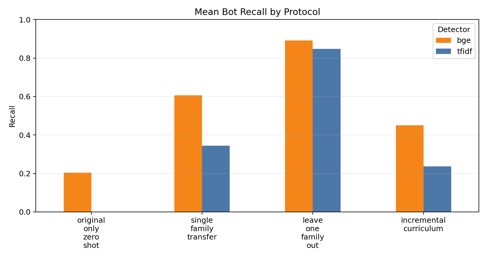
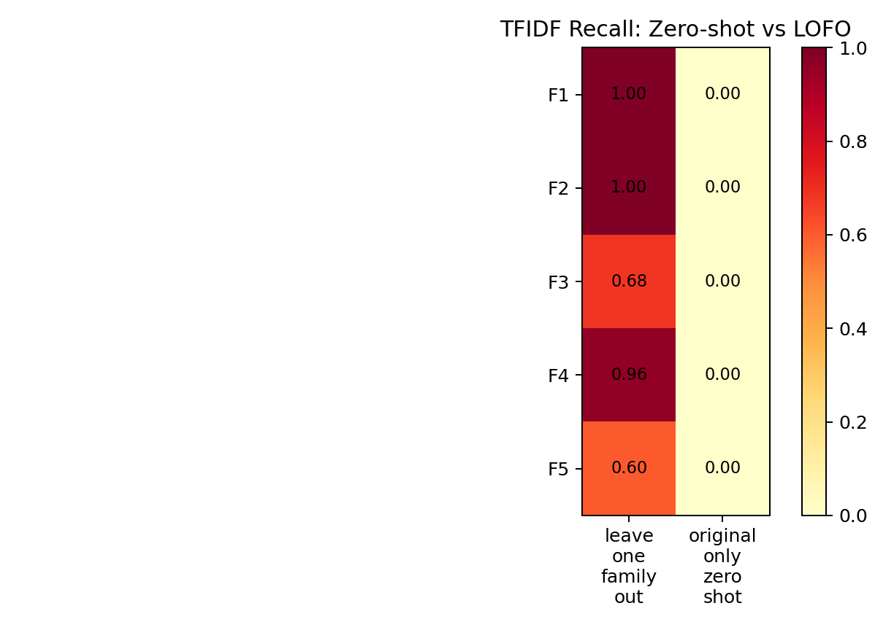
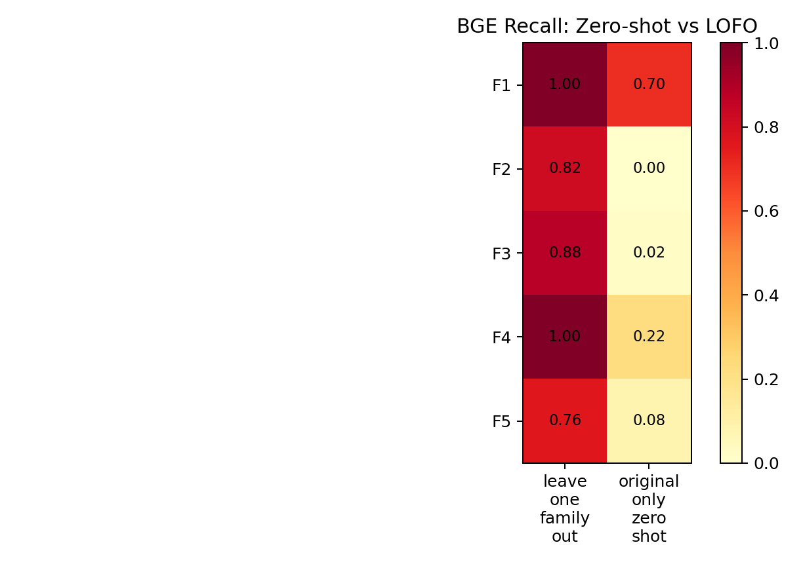
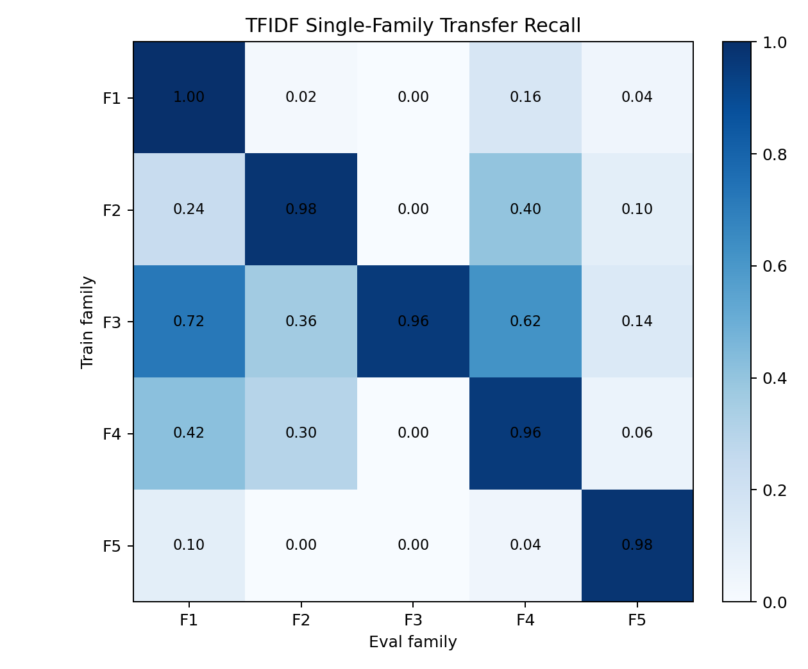
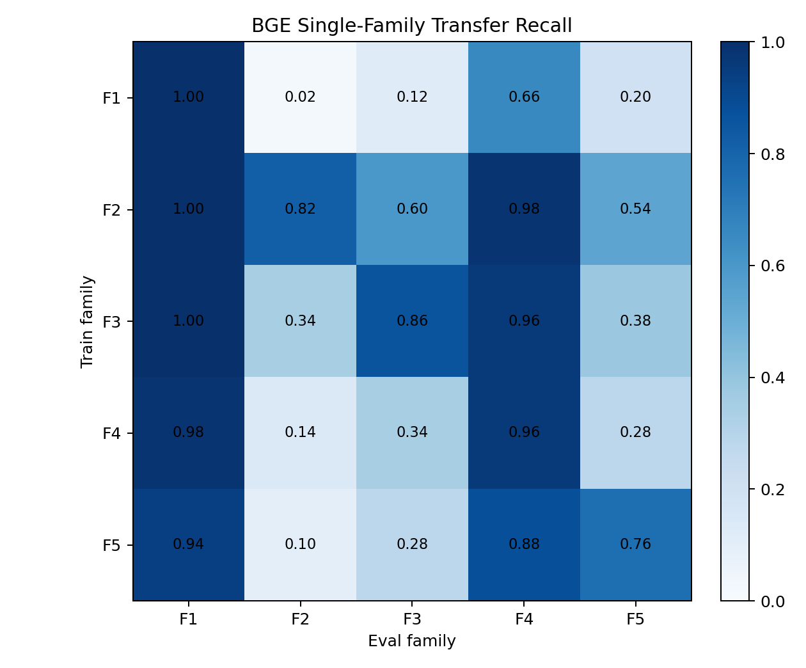
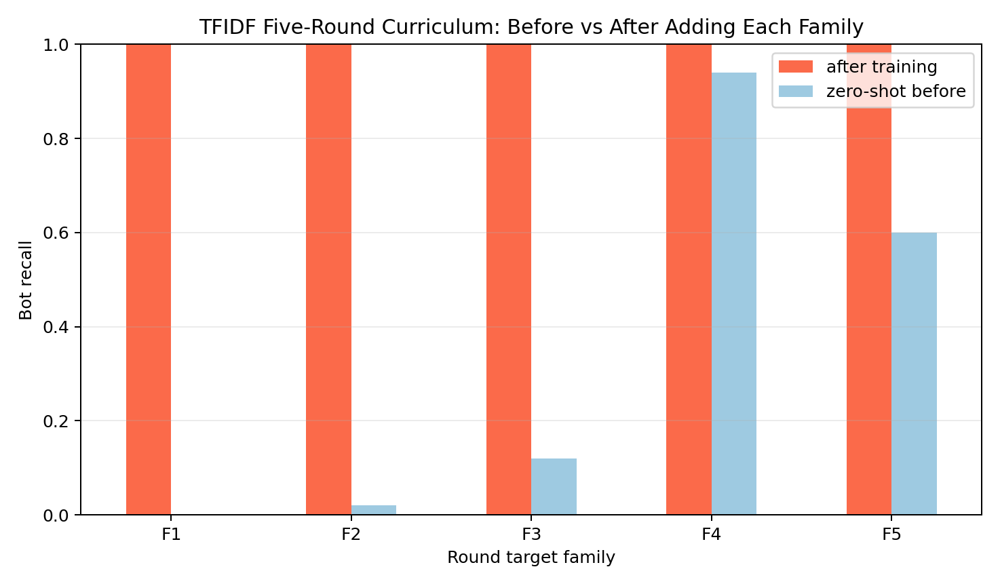
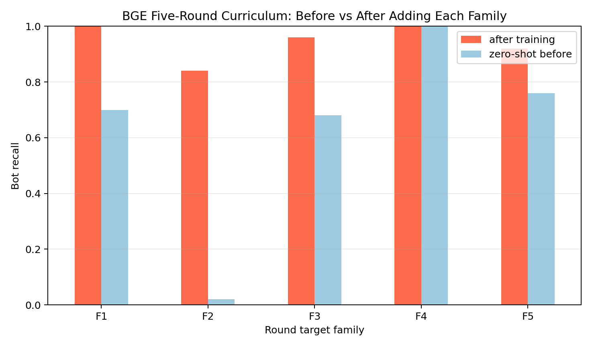

# 静态语言 Family 泛化基准报告

## 1. 实验设置

- family 数量：5
- 每个 family bot 数：50
- OpenAI-compatible 默认模型：`gpt-5.4`
- Gemini-compatible 默认模型：`gemini-3-pro-preview`
- dry_run：`False`
- BGE：`BAAI/bge-small-en-v1.5`

## 2. Family 定义

- `F1_original_architecture`：Family 1: Original Architecture
- `F2_tfidf_informed_language`：Family 2: TF-IDF-Informed Language
- `F3_human_anchor_local_tfidf`：Family 3: Human-Anchor Local TF-IDF
- `F4_peba_trait_prompt`：Family 4: PEBA Trait Prompt
- `F5_gemini_trait_prompt`：Family 5: Gemini Trait Prompt

## 3. 核心泛化结果

| protocol                | eval_family                 |      bge |   tfidf |
|:------------------------|:----------------------------|---------:|--------:|
| incremental_curriculum  | F1_original_architecture    | 0.7      |   0     |
| incremental_curriculum  | F2_tfidf_informed_language  | 0.01     |   0.01  |
| incremental_curriculum  | F3_human_anchor_local_tfidf | 0.273333 |   0.04  |
| incremental_curriculum  | F4_peba_trait_prompt        | 0.715    |   0.485 |
| incremental_curriculum  | F5_gemini_trait_prompt      | 0.472    |   0.296 |
| leave_one_family_out    | F1_original_architecture    | 1        |   1     |
| leave_one_family_out    | F2_tfidf_informed_language  | 0.82     |   1     |
| leave_one_family_out    | F3_human_anchor_local_tfidf | 0.88     |   0.68  |
| leave_one_family_out    | F4_peba_trait_prompt        | 1        |   0.96  |
| leave_one_family_out    | F5_gemini_trait_prompt      | 0.76     |   0.6   |
| original_only_zero_shot | F1_original_architecture    | 0.7      |   0     |
| original_only_zero_shot | F2_tfidf_informed_language  | 0        |   0     |
| original_only_zero_shot | F3_human_anchor_local_tfidf | 0.02     |   0     |
| original_only_zero_shot | F4_peba_trait_prompt        | 0.22     |   0     |
| original_only_zero_shot | F5_gemini_trait_prompt      | 0.08     |   0     |
| single_family_transfer  | F1_original_architecture    | 0.984    |   0.496 |
| single_family_transfer  | F2_tfidf_informed_language  | 0.284    |   0.332 |
| single_family_transfer  | F3_human_anchor_local_tfidf | 0.44     |   0.192 |
| single_family_transfer  | F4_peba_trait_prompt        | 0.888    |   0.436 |
| single_family_transfer  | F5_gemini_trait_prompt      | 0.432    |   0.264 |

## 4. 语言审计摘要

| family                      |   bot_count |   mean_word_count |   median_word_count |   mean_sentence_words |   high_risk_term_rate |   human_side_term_rate |   question_mark_count |   first_person_count |
|:----------------------------|------------:|------------------:|--------------------:|----------------------:|----------------------:|-----------------------:|----------------------:|---------------------:|
| F1_original_architecture    |          50 |            226.82 |               229.5 |               14.6252 |           0.00325552  |              0.0138967 |                  0.62 |                 0.28 |
| F2_tfidf_informed_language  |          50 |            122.08 |               124   |               13.3248 |           0.00234401  |              0.0217482 |                  1.74 |                 0.66 |
| F3_human_anchor_local_tfidf |          50 |            204.02 |               197   |               12.6689 |           0.00104602  |              0.0277993 |                  1.52 |                 0.72 |
| F4_peba_trait_prompt        |          50 |            111.36 |               110   |               11.4717 |           0.000906577 |              0.0232385 |                  1.44 |                 0.24 |
| F5_gemini_trait_prompt      |          50 |            157.42 |               158.5 |               14.5686 |           0.00210778  |              0.0123512 |                  3    |                 2.18 |

## 5. 解读口径

- `original_only_zero_shot` 测旧检测器对新 family 的零样本泛化。
- `single_family_transfer` 测见过某个新 family 后，能否迁移到其他 family。
- `leave_one_family_out` 测见过多数 family 后，对完整未见 family 的检出能力。
- `incremental_curriculum` 测检测器逐步吸收 family 后，对后续未见 family 的恢复曲线。
- F3 的局部 TF-IDF 只使用 2-3 个 human anchor 与当前 bot draft，不使用全局 bot/human 标签。
## 6. 图表

## 7. 五轮 Curriculum Pre/Post 泛化测试

这组图以 family 为单位构造 5 轮顺序测试。每一轮先测试目标 family 在尚未加入训练集时的 recall，然后把该 family 加入训练集，再测试同一 family 的训练后 recall。

- `zero-shot before`：训练集只包含 original human/bot 和之前轮次 family。
- `after training`：训练集加入当前轮次目标 family。

明细数据见 `curriculum_prepost_matrix.csv`。
