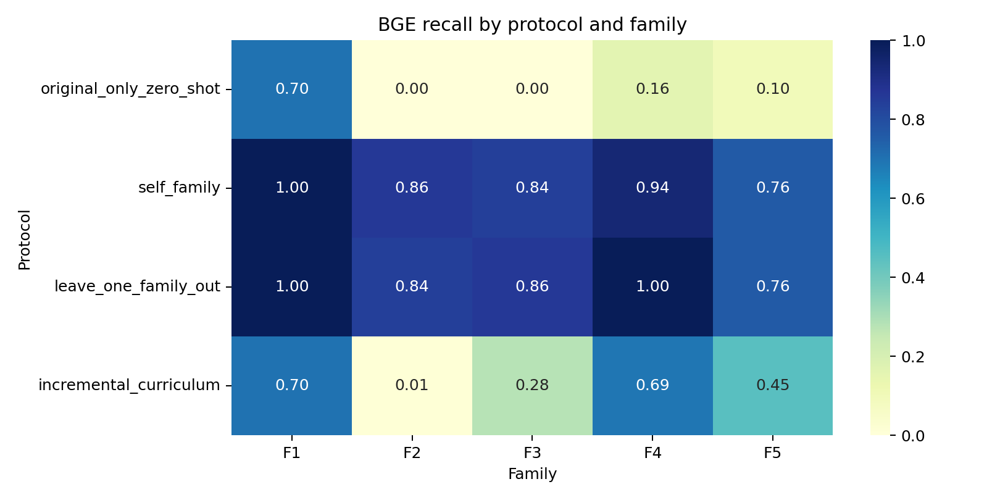
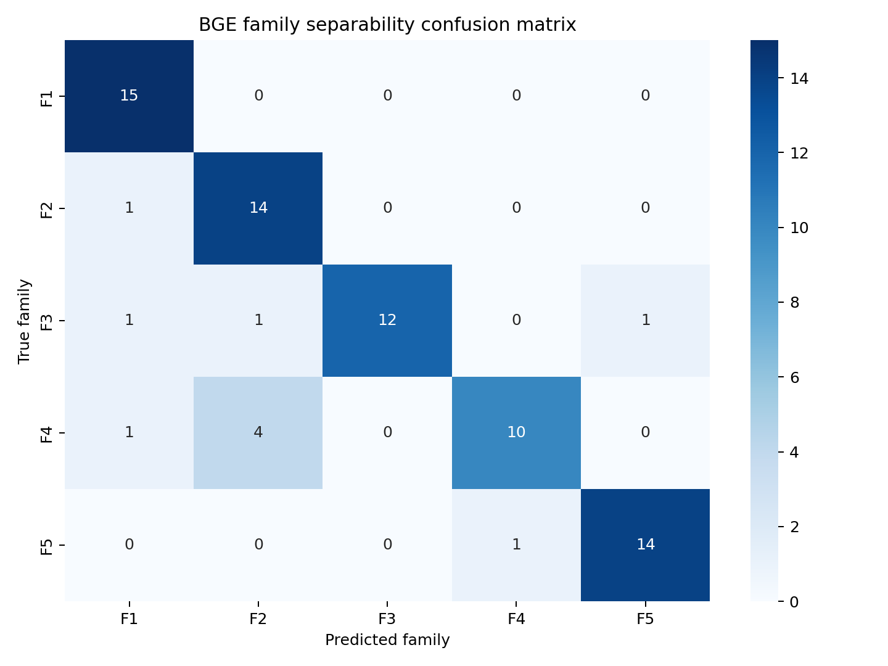
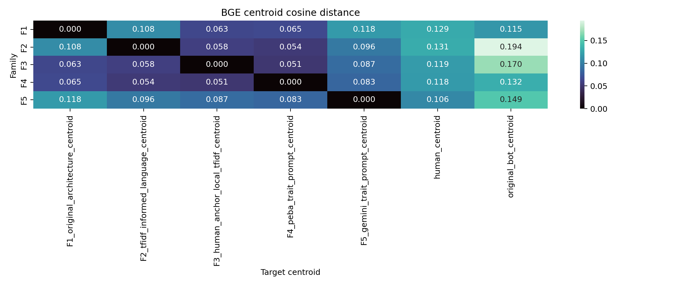
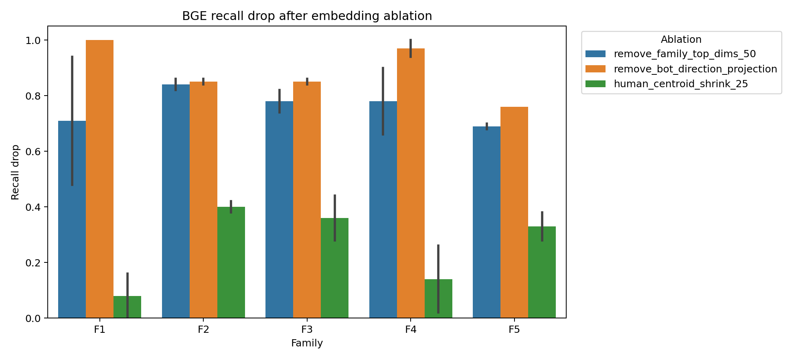

# BGE 为什么能区分 F1-F5：详细解读版

这份文档用更直白的方式解释 BGE 的结果。它和 TF-IDF 的分析不一样：TF-IDF 能告诉我们“哪些词”起作用，BGE 不能直接解释词，但可以解释 **embedding 空间的位置、方向、中心距离、消融后 recall 变化、以及典型样本**。

核心结论：

**BGE 确实能区分 F1-F5，family separability accuracy = 0.867。它不是靠具体词，而是靠每个 family 在语义 embedding 空间中的整体姿态和检测器学到的 bot-like 方向。**

## 1. 先看 BGE recall heatmap



这张图回答：BGE 在不同训练协议下能不能检出 F1-F5。

最重要的现象：

| 协议 | F1 | F2 | F3 | F4 | F5 | 含义 |
|---|---:|---:|---:|---:|---:|---|
| original-only zero-shot | 0.70 | 0.00 | 0.00 | 0.16 | 0.10 | 旧 BGE 能直接抓 F1，但抓不住 F2/F3 |
| self-family | 1.00 | 0.86 | 0.84 | 0.94 | 0.76 | 见过本 family 后，BGE 基本都能学会 |
| leave-one-family-out | 1.00 | 0.84 | 0.86 | 1.00 | 0.76 | 看过其他 family 后，也能泛化抓住留出 family |

这和 TF-IDF 很不一样。

TF-IDF zero-shot 对 F1-F5 全是 0，说明旧词项指纹失效了。BGE zero-shot 对 F1 有 0.70，说明 F1 虽然换了词，但整体语义姿态仍然像旧 bot。

所以 BGE 比 TF-IDF 更能抓“高层表达方式”：

- 不是某几个词；
- 而是整段评论的语义结构；
- 包括宏观政治判断、公共规范讨论、事实校正姿态、解释型组织方式等。

## 2. BGE 能不能直接分出五个 family



这是只用 BGE embedding 区分 F1-F5，不看 human，也不看 original bot。

准确率是 0.867。

具体看混淆矩阵：

- F1：15/15 全部分对。
- F2：14/15 分对，1 个被分成 F1。
- F3：12/15 分对，分别有 1 个像 F1、1 个像 F2、1 个像 F5。
- F4：10/15 分对，4 个被分成 F2，1 个被分成 F1。
- F5：14/15 分对，1 个被分成 F4。

这说明：

**BGE 不需要词项，也能看出 F1-F5 是不同分布。**

但它看到的不是“词频差异”，而是语义/话语姿态差异。

几个结论：

- F1 最独立：BGE 很容易认出它。
- F5 也很独立：Gemini trait family 在 embedding 空间里有自己的风格。
- F4 和 F2 有明显接近：F4 有 4 个被分成 F2，说明两者都有“纠错、校正、具体行动、事实澄清”这类语义姿态。
- F3 最混合：anchor 让它更像人，也让它不那么像单一 family，但仍能被大体分出。

## 3. Centroid geometry：离 human 近就安全吗



这张图看每个 family 的中心离 human centroid 和 original bot centroid 多远。

关键数值：

| Family | 到 human centroid 距离 | 到 original bot centroid 距离 | 初步解释 |
|---|---:|---:|---|
| F1 | 0.129 | 0.115 | 比 human 更靠近 old bot，所以 zero-shot 检出高 |
| F2 | 0.131 | 0.194 | 离 old bot 很远，所以 zero-shot 逃过 |
| F3 | 0.119 | 0.170 | 更靠近 human，所以 zero-shot 逃过 |
| F4 | 0.118 | 0.132 | 比较接近 human，但也不远离 old bot |
| F5 | 0.106 | 0.149 | 最接近 human centroid，但 LOFO 仍能检出 |

这里最重要的是 F5：

F5 离 human centroid 最近，但 LOFO recall 还有 0.76。

这说明：

**BGE 检测不只是看“离 human 中心远不远”。**

更准确地说，BGE 分类器学到的是一个方向：

```text
在 embedding 空间里，某些方向更 bot-like。
一个 family 可以离 human centroid 很近，但仍然沿着 bot-like direction 偏移。
```

这就是为什么需要消融实验。

## 4. 最关键：embedding 消融证明 BGE 靠方向检出



这张图是 BGE 分析里最重要的图。

三种消融：

- `remove_family_top_dims_50`：把 family 最重要的 50 个 embedding 维度替换成人类中心值。
- `remove_bot_direction_projection`：直接去掉检测器学到的 bot-like 方向。
- `human_centroid_shrink_25`：把样本整体往 human centroid 拉近 25%。

结果：

- 橙色 `remove_bot_direction_projection` 几乎让所有 family recall 大幅下降，很多直接归零。
- 蓝色 `remove_family_top_dims_50` 也显著下降。
- 绿色 `human_centroid_shrink_25` 下降较小，尤其 F1/F4 在 LOFO 下几乎不受影响。

这证明：

**BGE 主要靠“方向偏移”检测，而不是靠“距离 human 远”。**

如果只是把 embedding 往 human centroid 拉一点，很多 bot 仍然会被检出；但如果把 LR 学到的 bot-like projection 去掉，检测能力就塌了。

这就是 BGE 的白盒解释：

```text
BGE detector = 在 embedding 空间里学到一个 bot-like direction。
bot 文本沿这个方向投影越大，bot probability 越高。
```

## 5. 每个 family 的 BGE 语义指纹

下面不是词项解释，而是结合 centroid、recall、消融和 prototype 样本得到的语义解释。

### F1：宏观政治/制度评论姿态

F1 的 BGE zero-shot recall = 0.70，是五个 family 里最高。

原因：

- F1 到 original bot centroid 距离 0.115，比到 human centroid 0.129 更近。
- F1 的高概率样本常是宏观地谈地缘政治、国家关系、制度风险。
- prototype 里最高概率样本谈 South Korea、Japan、China、North Korea、US alliance system。

这说明 F1 虽然词项上避开了旧 TF-IDF，但语义姿态还是接近旧 bot：

```text
具体新闻 -> 宏观局势 -> 制度/联盟/民主/政府风险 -> 总结性判断
```

BGE 很擅长抓这种整体语义组织。

### F2：事实校正/数字比较姿态

F2 zero-shot recall = 0.00，但 LOFO recall = 0.84。

这说明：

- 对旧 BGE 来说，F2 不像 old bot。
- 但当 BGE 看过其他 family 后，它能学到 F2 的生成式校正姿态。

F2 的 prototype 高概率样本集中在：

- preliminary estimate；
- 100 to 300 range；
- yearly comparison；
- exact number；
- fine print matters。

所以 F2 的语义指纹是：

```text
不直接表态，而是围绕数字、范围、统计、口径、比较方式做校正。
```

这比 F1 更像 Reddit 讨论，但仍然是一种稳定姿态。

### F3：anchor 后更像人，但仍有公共道德判断方向

F3 zero-shot recall = 0.00，但 LOFO recall = 0.86。

F3 到 human centroid 距离 0.119，比 F1/F2 更近，说明 anchor 策略确实让它在 BGE 空间里更 human-like。

但为什么 LOFO 还能高？

prototype 显示 F3 高概率样本通常围绕：

- Gaza posts；
- government freakout；
- free speech；
- dissent；
- public safety；
- basic liberties。

这不是表层 AI 腔，而是一个稳定的公共道德/自由权利判断方向。

也就是说：

```text
F3 在局部语言上更像人，但整体议论路径仍然稳定：
事件 -> 政府过度反应 -> 言论自由/基本权利 -> 道德判断。
```

BGE 能抓到这种语义路径。

### F4：纠错、行动定义、公共议题聚焦

F4 zero-shot recall = 0.16，LOFO recall = 1.00。

F4 到 human centroid 距离 0.118，但到 original bot centroid 也不远，0.132。

prototype 高概率样本里有很明显的模式：

- “global indifference” is doing a lot there；
- say ceasefire and aid access；
- what action actually means；
- grief with no policy attached。

这说明 F4 的 BGE 指纹是：

```text
纠正说法 -> 要求具体行动定义 -> 把情绪口号转成政策/行动框架。
```

这和 F2 接近，所以 family separability 里 F4 有 4 个被判成 F2。

### F5：离 human 最近，但有 Gemini 式组织节奏

F5 到 human centroid 最近，距离 0.106。

但：

- self recall = 0.76；
- LOFO recall = 0.76；
- BGE 仍能区分 F5，family separability 中 14/15 分对。

这说明 F5 的文本整体更 human-like，但仍有自己的 embedding pattern。

prototype 高概率样本里常见：

- concrete timeline；
- daily costs stabilize；
- high-level chess match；
- average person trying to make it through；
- just to be accurate。

这像一种 Gemini 式组织：

```text
先承认宏观议题 -> 转向普通人的具体处境 -> 插入准确性校正 -> 做平衡总结。
```

所以 F5 的问题不是离 human 太远，而是有稳定的“平衡解释节奏”。

## 6. BGE 和 TF-IDF 的区别

TF-IDF 的结论：

```text
F1-F5 会留下词项指纹。
检测器通过重复词、短语、局部词组组合检出。
```

BGE 的结论：

```text
F1-F5 会留下语义姿态指纹。
检测器通过 embedding 空间中的 bot-like direction 检出。
```

两者互补：

- TF-IDF 抓表层词项稳定性。
- BGE 抓高层语义组织稳定性。

因此，即使我们修掉 TF-IDF 词项，BGE 仍可能抓住：

- 宏观政治解释路径；
- 稳定的事实校正姿态；
- 稳定的公共道德判断；
- 稳定的行动定义/政策化表达；
- 模型平台的组织节奏。

## 7. 对我们研究的启发

BGE 的结果比 TF-IDF 更支持“泛化性 benchmark”的方向。

因为它说明：

1. 只改词不够，embedding 语义空间仍可能暴露生成机制。
2. family 内部不能只有一个稳定语义姿态。
3. 不能让所有 persona 都把新闻转成同一类评论路径。
4. 即使 family 离 human centroid 近，也可能沿 bot-like direction 偏移。
5. 检测器一旦看过几个 family，就能学到跨 family 的抽象生成方向。

后续如果要改生成器，不应该只要求“更口语”，还应该增加：

- 议论路径多样性；
- 话题处理方式多样性；
- 情绪强度多样性；
- 有些人只吐槽，不总结；
- 有些人只问问题，不给框架；
- 有些人只讲个人经验，不上升到公共规范；
- 有些人说一半就停，不做完整平衡分析。

最终论文表述可以这样写：

> TF-IDF reveals lexical-family fingerprints, while BGE reveals semantic-geometry fingerprints. Static bot families can evade old lexical detectors, but once detectors observe related families, they recover by learning either repeated lexical patterns or shared embedding-space directions. This supports evaluating detectors under held-out family and cross-generation protocols rather than only static in-distribution splits.

