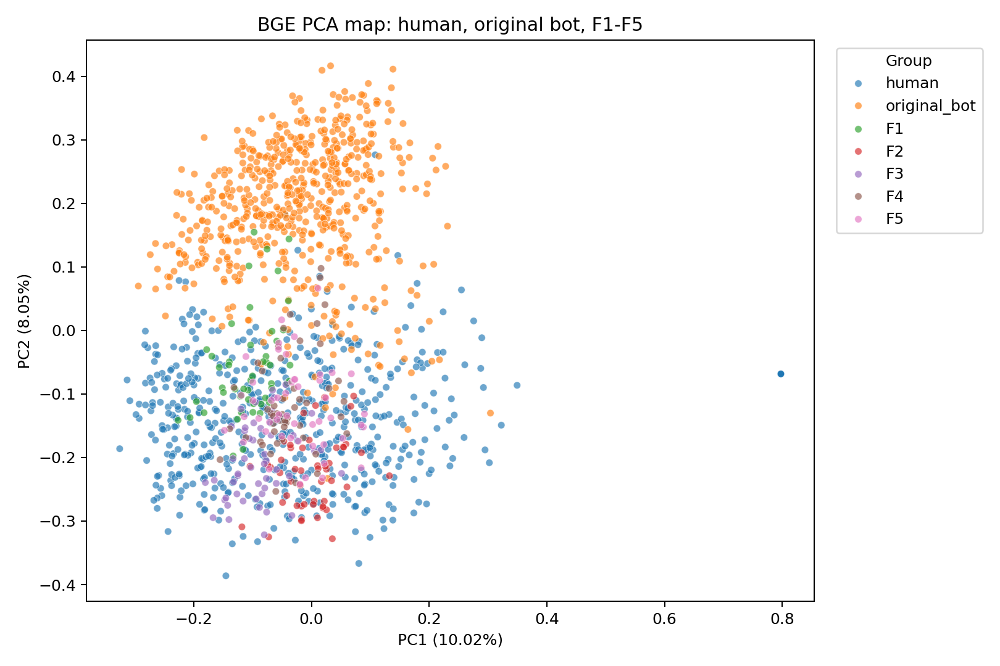

# BGE 几何白盒与消融分析

- 输入目录：`static_language/outputs/full_5family_50bot_3round_gpt54_20260601`
- 输出目录：`static_language/outputs/full_5family_50bot_3round_gpt54_20260601/bge_geometry_analysis`
- 分析对象：`BGE embedding + LogisticRegression`
- 白盒公式：`bot_logit = intercept + embedding dot coef`

## 1. BGE 和 TF-IDF 的差异

BGE 不能像 TF-IDF 一样解释为具体词项。它的可解释对象是 embedding 空间中的方向、距离、中心和样本原型。因此本报告用几何消融回答：哪些 embedding 方向让检测器把 family 判成 bot。

## 2. BGE 检出概况

| protocol                | family_short   |   recall |   mean_probability |
|:------------------------|:---------------|---------:|-------------------:|
| incremental_curriculum  | F1             |     0.7  |           0.575653 |
| incremental_curriculum  | F2             |     0    |           0.117041 |
| incremental_curriculum  | F2             |     0.02 |           0.213176 |
| incremental_curriculum  | F3             |     0    |           0.184327 |
| incremental_curriculum  | F3             |     0.12 |           0.338105 |
| incremental_curriculum  | F3             |     0.72 |           0.612757 |
| incremental_curriculum  | F4             |     0.16 |           0.365486 |
| incremental_curriculum  | F4             |     0.62 |           0.528704 |
| incremental_curriculum  | F4             |     0.98 |           0.789166 |
| incremental_curriculum  | F4             |     1    |           0.845207 |
| incremental_curriculum  | F5             |     0.1  |           0.238214 |
| incremental_curriculum  | F5             |     0.18 |           0.317444 |
| incremental_curriculum  | F5             |     0.56 |           0.521909 |
| incremental_curriculum  | F5             |     0.66 |           0.584947 |
| incremental_curriculum  | F5             |     0.76 |           0.603986 |
| leave_one_family_out    | F1             |     1    |           0.907182 |
| leave_one_family_out    | F2             |     0.84 |           0.64066  |
| leave_one_family_out    | F3             |     0.86 |           0.71065  |
| leave_one_family_out    | F4             |     1    |           0.870787 |
| leave_one_family_out    | F5             |     0.76 |           0.603986 |
| original_only_zero_shot | F1             |     0.7  |           0.575653 |
| original_only_zero_shot | F2             |     0    |           0.117041 |
| original_only_zero_shot | F3             |     0    |           0.184327 |
| original_only_zero_shot | F4             |     0.16 |           0.365486 |
| original_only_zero_shot | F5             |     0.1  |           0.238214 |
| self_family             | F1             |     1    |           0.803837 |
| self_family             | F2             |     0.86 |           0.634943 |
| self_family             | F3             |     0.84 |           0.640016 |
| self_family             | F4             |     0.94 |           0.723738 |
| self_family             | F5             |     0.76 |           0.636608 |

## 3. BGE 能否区分五个 family

- family separability accuracy：`0.867`
- 这个结果回答：即使不看词项，只看语义 embedding，五个 family 是否也形成了可分布结构。

## 4. Centroid Geometry

这部分看每个 family 的中心离 human、original bot 和其他 family 中心有多远。如果一个 family 离 human centroid 近但仍被检出，说明检测器不是只看“离人远不远”，而是看某个 bot-like 方向。

| family_short   | target_centroid       |   cosine_distance |   cosine_similarity |
|:---------------|:----------------------|------------------:|--------------------:|
| F1             | human_centroid        |          0.129004 |            0.870996 |
| F1             | original_bot_centroid |          0.115037 |            0.884963 |
| F2             | human_centroid        |          0.130608 |            0.869392 |
| F2             | original_bot_centroid |          0.193517 |            0.806483 |
| F3             | human_centroid        |          0.119348 |            0.880652 |
| F3             | original_bot_centroid |          0.169707 |            0.830293 |
| F4             | human_centroid        |          0.118076 |            0.881924 |
| F4             | original_bot_centroid |          0.131555 |            0.868445 |
| F5             | human_centroid        |          0.106194 |            0.893806 |
| F5             | original_bot_centroid |          0.148932 |            0.851068 |

## 5. Embedding 消融说明了什么

最重要的消融是 `remove_bot_direction_projection`。如果它让 recall 下降，说明 BGE 主要靠 LR 学到的 bot-like embedding 方向。`human_centroid_shrink_25` 是对照：如果只是向 human 中心靠近但 recall 不怎么降，说明检测不是简单中心距离问题。

| protocol             | family_short   | ablation                           |   original_recall |   ablated_recall |   recall_drop |   mean_probability_drop |
|:---------------------|:---------------|:-----------------------------------|------------------:|-----------------:|--------------:|------------------------:|
| leave_one_family_out | F1             | remove_bot_direction_projection    |              1    |             0    |          1    |                0.781071 |
| leave_one_family_out | F1             | remove_family_direction_projection |              1    |             0    |          1    |                0.816616 |
| leave_one_family_out | F1             | remove_family_top_dims_50          |              1    |             0.52 |          0.48 |                0.387362 |
| leave_one_family_out | F1             | remove_sample_top_dims_20          |              1    |             0.86 |          0.14 |                0.268781 |
| leave_one_family_out | F1             | human_centroid_shrink_25           |              1    |             1    |          0    |                0.132974 |
| leave_one_family_out | F2             | remove_bot_direction_projection    |              0.84 |             0    |          0.84 |                0.507693 |
| leave_one_family_out | F2             | remove_family_direction_projection |              0.84 |             0    |          0.84 |                0.548637 |
| leave_one_family_out | F2             | remove_family_top_dims_50          |              0.84 |             0.02 |          0.82 |                0.393514 |
| leave_one_family_out | F2             | remove_sample_top_dims_20          |              0.84 |             0.04 |          0.8  |                0.35529  |
| leave_one_family_out | F2             | human_centroid_shrink_25           |              0.84 |             0.46 |          0.38 |                0.164609 |
| leave_one_family_out | F3             | remove_bot_direction_projection    |              0.86 |             0    |          0.86 |                0.586948 |
| leave_one_family_out | F3             | remove_family_direction_projection |              0.86 |             0    |          0.86 |                0.629095 |
| leave_one_family_out | F3             | remove_family_top_dims_50          |              0.86 |             0.12 |          0.74 |                0.396575 |
| leave_one_family_out | F3             | remove_sample_top_dims_20          |              0.86 |             0.22 |          0.64 |                0.319643 |
| leave_one_family_out | F3             | human_centroid_shrink_25           |              0.86 |             0.58 |          0.28 |                0.164917 |
| leave_one_family_out | F4             | remove_bot_direction_projection    |              1    |             0    |          1    |                0.744928 |
| leave_one_family_out | F4             | remove_family_direction_projection |              1    |             0    |          1    |                0.774793 |
| leave_one_family_out | F4             | remove_family_top_dims_50          |              1    |             0.34 |          0.66 |                0.408332 |
| leave_one_family_out | F4             | remove_sample_top_dims_20          |              1    |             0.66 |          0.34 |                0.314381 |
| leave_one_family_out | F4             | human_centroid_shrink_25           |              1    |             0.98 |          0.02 |                0.154059 |
| leave_one_family_out | F5             | remove_bot_direction_projection    |              0.76 |             0    |          0.76 |                0.47992  |
| leave_one_family_out | F5             | remove_family_direction_projection |              0.76 |             0.02 |          0.74 |                0.485547 |
| leave_one_family_out | F5             | remove_family_top_dims_50          |              0.76 |             0.06 |          0.7  |                0.31593  |
| leave_one_family_out | F5             | remove_sample_top_dims_20          |              0.76 |             0.08 |          0.68 |                0.334366 |
| leave_one_family_out | F5             | human_centroid_shrink_25           |              0.76 |             0.38 |          0.38 |                0.149319 |
| self_family          | F1             | remove_bot_direction_projection    |              1    |             0    |          1    |                0.652828 |
| self_family          | F1             | remove_family_direction_projection |              1    |             0    |          1    |                0.729721 |
| self_family          | F1             | remove_family_top_dims_50          |              1    |             0.06 |          0.94 |                0.478002 |
| self_family          | F1             | remove_sample_top_dims_20          |              1    |             0.26 |          0.74 |                0.364771 |
| self_family          | F1             | human_centroid_shrink_25           |              1    |             0.84 |          0.16 |                0.179664 |
| self_family          | F2             | remove_family_top_dims_50          |              0.86 |             0    |          0.86 |                0.381984 |
| self_family          | F2             | remove_bot_direction_projection    |              0.86 |             0    |          0.86 |                0.497615 |
| self_family          | F2             | remove_family_direction_projection |              0.86 |             0    |          0.86 |                0.55039  |
| self_family          | F2             | remove_sample_top_dims_20          |              0.86 |             0.04 |          0.82 |                0.350638 |
| self_family          | F2             | human_centroid_shrink_25           |              0.86 |             0.44 |          0.42 |                0.161067 |
| self_family          | F3             | remove_bot_direction_projection    |              0.84 |             0    |          0.84 |                0.486508 |
| self_family          | F3             | remove_family_direction_projection |              0.84 |             0    |          0.84 |                0.564078 |
| self_family          | F3             | remove_family_top_dims_50          |              0.84 |             0.02 |          0.82 |                0.393175 |
| self_family          | F3             | remove_sample_top_dims_20          |              0.84 |             0.1  |          0.74 |                0.318898 |
| self_family          | F3             | human_centroid_shrink_25           |              0.84 |             0.4  |          0.44 |                0.165894 |
| self_family          | F4             | remove_bot_direction_projection    |              0.94 |             0    |          0.94 |                0.575164 |
| self_family          | F4             | remove_family_direction_projection |              0.94 |             0    |          0.94 |                0.638778 |
| self_family          | F4             | remove_family_top_dims_50          |              0.94 |             0.04 |          0.9  |                0.419745 |
| self_family          | F4             | remove_sample_top_dims_20          |              0.94 |             0.06 |          0.88 |                0.366573 |
| self_family          | F4             | human_centroid_shrink_25           |              0.94 |             0.68 |          0.26 |                0.180278 |
| self_family          | F5             | remove_bot_direction_projection    |              0.76 |             0    |          0.76 |                0.479392 |
| self_family          | F5             | remove_family_direction_projection |              0.76 |             0    |          0.76 |                0.528613 |
| self_family          | F5             | remove_family_top_dims_50          |              0.76 |             0.08 |          0.68 |                0.325004 |
| self_family          | F5             | remove_sample_top_dims_20          |              0.76 |             0.12 |          0.64 |                0.340135 |
| self_family          | F5             | human_centroid_shrink_25           |              0.76 |             0.48 |          0.28 |                0.157239 |

## 6. Prototype-Based Interpretation

BGE 维度不可读，所以要看样本原型。下面列出部分高概率、低概率、离 human 最近、离 original bot 最近、消融下降最大的样本。

| detector_id      | family_short   | case_type                           |      value | user_id                         | doc_snippet                                                                                                                                                                                                                                                                                                                                                                                  |
|:-----------------|:---------------|:------------------------------------|-----------:|:--------------------------------|:---------------------------------------------------------------------------------------------------------------------------------------------------------------------------------------------------------------------------------------------------------------------------------------------------------------------------------------------------------------------------------------------|
| D0_original_only | F1             | highest_bge_probability             |  0.880928  | f1_original_architecture_038    | This is one of the better trend lines in Asia right now. South Korea and Japan do not have to suddenly trust each other to see that the security math has changed with China, North Korea, and a shakier world economy. Better ties also help the US alliance system, which matters more than people admit. Small caveat though, these resets are fragile, and domestic politics or old h... |
| D0_original_only | F1             | lowest_bge_probability              |  0.233023  | f1_original_architecture_010    | Can we maybe stop treating first-hour claims in a war zone like settled fact? If the US assessment is 100 to 300 and preliminary, that matters. Not because 100 dead is somehow acceptable, obviously, but because bad numbers get turned into instant political weapons and then nobody wants to correct the record. That is how governments, media, and the public all lose credibility... |
| D0_original_only | F1             | highest_bot_direction_score         |  0.212989  | f1_original_architecture_038    | This is one of the better trend lines in Asia right now. South Korea and Japan do not have to suddenly trust each other to see that the security math has changed with China, North Korea, and a shakier world economy. Better ties also help the US alliance system, which matters more than people admit. Small caveat though, these resets are fragile, and domestic politics or old h... |
| D0_original_only | F1             | lowest_bot_direction_score          |  0.0258606 | f1_original_architecture_010    | Can we maybe stop treating first-hour claims in a war zone like settled fact? If the US assessment is 100 to 300 and preliminary, that matters. Not because 100 dead is somehow acceptable, obviously, but because bad numbers get turned into instant political weapons and then nobody wants to correct the record. That is how governments, media, and the public all lose credibility... |
| D0_original_only | F1             | nearest_human_centroid              |  0.169024  | f1_original_architecture_048    | This is what wartime panic does to a democracy. First it gets framed as unity, then it turns into policing speech and making examples of people for the wrong opinion. You can support Israelis not being murdered and still think arresting people over posts defending Gaza is a major red flag. A state that cannot tolerate dissent during a crisis usually comes out of the crisis w... |
| D0_original_only | F1             | nearest_original_bot_centroid       |  0.171759  | f1_original_architecture_038    | This is one of the better trend lines in Asia right now. South Korea and Japan do not have to suddenly trust each other to see that the security math has changed with China, North Korea, and a shakier world economy. Better ties also help the US alliance system, which matters more than people admit. Small caveat though, these resets are fragile, and domestic politics or old h... |
| D0_original_only | F1             | largest_bot_direction_ablation_drop |  0.717442  | f1_original_architecture_038    | This is one of the better trend lines in Asia right now. South Korea and Japan do not have to suddenly trust each other to see that the security math has changed with China, North Korea, and a shakier world economy. Better ties also help the US alliance system, which matters more than people admit. Small caveat though, these resets are fragile, and domestic politics or old h... |
| D0_original_only | F2             | highest_bge_probability             |  0.380373  | f2_tfidf_informed_language_029  | That 100 to 300 range is kind of the point though. People rushed to absolute certainty within hours, and weeks later it’s still a preliminary estimate with a 200-person gap. Not exactly a small detail. Yeah, it’s obviously horrifying, but this is the kind of stat where the fine print matters a lot. What exact number are they using, and what is the yearly comparison actually ... |
| D0_original_only | F2             | lowest_bge_probability              |  0.0334029 | f2_tfidf_informed_language_023  | As a dad, the part that sticks with me is the 3 weeks detail. People can argue over exact counts if they want, but kids dying at that pace should be front-page every day. Am I missing some big caveat in how Save the Children is counting this, or are people just numb now? Same here. I’ve got kids too and the 3 weeks part is the detail I can’t shake. I just also think people a... |
| D0_original_only | F2             | highest_bot_direction_score         |  0.0670869 | f2_tfidf_informed_language_029  | That 100 to 300 range is kind of the point though. People rushed to absolute certainty within hours, and weeks later it’s still a preliminary estimate with a 200-person gap. Not exactly a small detail. Yeah, it’s obviously horrifying, but this is the kind of stat where the fine print matters a lot. What exact number are they using, and what is the yearly comparison actually ... |
| D0_original_only | F2             | lowest_bot_direction_score          | -0.101555  | f2_tfidf_informed_language_023  | As a dad, the part that sticks with me is the 3 weeks detail. People can argue over exact counts if they want, but kids dying at that pace should be front-page every day. Am I missing some big caveat in how Save the Children is counting this, or are people just numb now? Same here. I’ve got kids too and the 3 weeks part is the detail I can’t shake. I just also think people a... |
| D0_original_only | F2             | nearest_human_centroid              |  0.202574  | f2_tfidf_informed_language_020  | Whirling disease is nasty stuff. If they had to euthanize 40,000 trout, I want to know how far it had already spread before they caught it. Fish farms and stocking programs can turn one bad sample into a whole mess fast. Yeah but "call for action" without saying what action is how these threads go in circles. The concrete part is the count. If this is Gaza health ministry nu... |
| D0_original_only | F2             | nearest_original_bot_centroid       |  0.240784  | f2_tfidf_informed_language_007  | "Preliminary" is doing a lot of work here. The number swing from 100 to 300 is huge. I get that first reports are messy, but I'd want to know what the US assessment is actually based on before treating that range like settled fact. Yeah but this is exactly why people keep asking for the breakdown. "All global conflict annually since 2019" is such a massive claim that the sou... |
| D0_original_only | F2             | largest_bot_direction_ablation_drop |  0.216888  | f2_tfidf_informed_language_029  | That 100 to 300 range is kind of the point though. People rushed to absolute certainty within hours, and weeks later it’s still a preliminary estimate with a 200-person gap. Not exactly a small detail. Yeah, it’s obviously horrifying, but this is the kind of stat where the fine print matters a lot. What exact number are they using, and what is the yearly comparison actually ... |
| D0_original_only | F3             | highest_bge_probability             |  0.489194  | f3_human_anchor_local_tfidf_004 | You really do not need to agree on the war to see this is wrong. Dragging a person in over social media stuff is ugly any way you slice it, especially from a country that loves talking about being free and open. Panic after an attack is not some magic excuse for the government to start trampling basic liberties. Maybe every case has its own details, fine, but when this start... |
| D0_original_only | F3             | lowest_bge_probability              |  0.066157  | f3_human_anchor_local_tfidf_013 | Dragging people in over Gaza stuff online is a real bad look. Were they openly telling others to go hurt anybody? Put that out there and prosecute that. But when it's just pro-Palestinian sentiment getting treated as a threat, that's a government freakout dressed up as public safety, and it goes to a dark place fast. Ignored by who though? I don't buy that at all. Nobody is ... |
| D0_original_only | F3             | highest_bot_direction_score         |  0.0931544 | f3_human_anchor_local_tfidf_004 | You really do not need to agree on the war to see this is wrong. Dragging a person in over social media stuff is ugly any way you slice it, especially from a country that loves talking about being free and open. Panic after an attack is not some magic excuse for the government to start trampling basic liberties. Maybe every case has its own details, fine, but when this start... |
| D0_original_only | F3             | lowest_bot_direction_score          | -0.0594787 | f3_human_anchor_local_tfidf_013 | Dragging people in over Gaza stuff online is a real bad look. Were they openly telling others to go hurt anybody? Put that out there and prosecute that. But when it's just pro-Palestinian sentiment getting treated as a threat, that's a government freakout dressed up as public safety, and it goes to a dark place fast. Ignored by who though? I don't buy that at all. Nobody is ... |
| D0_original_only | F3             | nearest_human_centroid              |  0.189625  | f3_human_anchor_local_tfidf_029 | If somebody got hauled in just for posting pro Gaza stuff then yeah, that's insane. But half these stories leave out the part that matters. There is a big difference between saying Palestinians are being slaughtered, mourning the dead, wanting a ceasefire, vs praising the killings, telling others to do more of them, or acting as PR for a banned armed group. Same bucket? No. ... |
| D0_original_only | F3             | nearest_original_bot_centroid       |  0.224304  | f3_human_anchor_local_tfidf_039 | If all they did was say people in Gaza are being crushed, dragging them in over that is absurd. This is the kind of crap governments pull when they want every dissenting voice stamped out. Supporting Hamas is one thing. Saying civilians are getting bombed to hell and shouldn't pay for it is another. Too many people in power keep acting like those are the same thing because i... |
| D0_original_only | F3             | largest_bot_direction_ablation_drop |  0.325709  | f3_human_anchor_local_tfidf_004 | You really do not need to agree on the war to see this is wrong. Dragging a person in over social media stuff is ugly any way you slice it, especially from a country that loves talking about being free and open. Panic after an attack is not some magic excuse for the government to start trampling basic liberties. Maybe every case has its own details, fine, but when this start... |
| D0_original_only | F4             | highest_bge_probability             |  0.793898  | f4_peba_trait_prompt_023        | “Global indifference” is doing a lot there. People do care, it’s governments that keep treating outrage like noise. If you mean something concrete, say ceasefire and aid access, not just “urgent action.” The part that keeps getting blurred is what action actually means. If people mean ceasefire and aid access, say that plainly; otherwise it starts sounding like grief with no... |
| D0_original_only | F4             | lowest_bge_probability              |  0.0765399 | f4_peba_trait_prompt_042        | Yep. Editing wire copy for house style is one thing, but changing a direct quote is a different animal. If they just fixed grammar, fine, but if they softened the meaning then readers are getting a cleaned-up version of reality. At that point why even pretend it's AP or Reuters copy. This looks like the wrong thread entirely. You're talking about displaced children in Ukrain... |
| D0_original_only | F4             | highest_bot_direction_score         |  0.174734  | f4_peba_trait_prompt_023        | “Global indifference” is doing a lot there. People do care, it’s governments that keep treating outrage like noise. If you mean something concrete, say ceasefire and aid access, not just “urgent action.” The part that keeps getting blurred is what action actually means. If people mean ceasefire and aid access, say that plainly; otherwise it starts sounding like grief with no... |
| D0_original_only | F4             | lowest_bot_direction_score          | -0.0502785 | f4_peba_trait_prompt_042        | Yep. Editing wire copy for house style is one thing, but changing a direct quote is a different animal. If they just fixed grammar, fine, but if they softened the meaning then readers are getting a cleaned-up version of reality. At that point why even pretend it's AP or Reuters copy. This looks like the wrong thread entirely. You're talking about displaced children in Ukrain... |
| D0_original_only | F4             | nearest_human_centroid              |  0.183152  | f4_peba_trait_prompt_005        | If this is true, it's a pretty ugly sign. You can't say you're the only democracy in the region and then start arresting people over posts defending civilians in Gaza. There is a line between policing incitement and punishing dissent, and a lot of governments suddenly pretend that line is blurry when people are scared. You can think he’s a mess and still think this is ugly. ... |
| D0_original_only | F4             | nearest_original_bot_centroid       |  0.220382  | f4_peba_trait_prompt_010        | Addiction is ugly enough without turning it into campaign material. You can think Hunter Biden has made a mess of his life and still recognise that public point-scoring over someone getting sober is pretty rotten. Also not exactly a great message to send to every family dealing with this in private. I think you’ve crossed wires here. This comment is about displaced children ... |
| D0_original_only | F4             | largest_bot_direction_ablation_drop |  0.630413  | f4_peba_trait_prompt_023        | “Global indifference” is doing a lot there. People do care, it’s governments that keep treating outrage like noise. If you mean something concrete, say ceasefire and aid access, not just “urgent action.” The part that keeps getting blurred is what action actually means. If people mean ceasefire and aid access, say that plainly; otherwise it starts sounding like grief with no... |
| D0_original_only | F5             | highest_bge_probability             |  0.647484  | f5_gemini_trait_prompt_021      | Most people aren't tuning into this debate to worry about global diplomacy; they want a concrete timeline on when daily costs will actually stabilize. I get that foreign policy matters in the grand scheme of things. Just to be accurate, though, treating the whole thing like a high-level chess match completely ignores that the average person is just trying to make it through ... |
| D0_original_only | F5             | lowest_bge_probability              |  0.0380411 | f5_gemini_trait_prompt_035      | Hold up. He wasn't born in the US, right? So he literally can't run. Are people actually talking about changing the rules for this, or is it just clickbait? idk I'm kind of torn on this. dragging his recovery through the mud is super gross, but aren't the questions about the overseas money still pretty valid? if a guy on my shift had those kinds of sketchy finances, manageme... |
| D0_original_only | F5             | highest_bot_direction_score         |  0.131325  | f5_gemini_trait_prompt_021      | Most people aren't tuning into this debate to worry about global diplomacy; they want a concrete timeline on when daily costs will actually stabilize. I get that foreign policy matters in the grand scheme of things. Just to be accurate, though, treating the whole thing like a high-level chess match completely ignores that the average person is just trying to make it through ... |
| D0_original_only | F5             | lowest_bot_direction_score          | -0.0936521 | f5_gemini_trait_prompt_035      | Hold up. He wasn't born in the US, right? So he literally can't run. Are people actually talking about changing the rules for this, or is it just clickbait? idk I'm kind of torn on this. dragging his recovery through the mud is super gross, but aren't the questions about the overseas money still pretty valid? if a guy on my shift had those kinds of sketchy finances, manageme... |
| D0_original_only | F5             | nearest_human_centroid              |  0.21008   | f5_gemini_trait_prompt_028      | wait they're getting arrested just for posting? kinda wild if true. anyone know what they actually said? hard to tell what's going on lately yeah pretty sure you gotta be a natural born citizen. feels like random clickbait? no way they're actually trying to change the constitution just for him right now yeah the timeline is what gets me. like how do you organize massive fore... |
| D0_original_only | F5             | nearest_original_bot_centroid       |  0.247812  | f5_gemini_trait_prompt_029      | A margin of 100 to 300 is quite a massive gap. It's a horrific loss of life either way, obviously. But the fact that US intelligence is working with a 200-person variance just shows how completely unreliable the initial numbers are on the ground. Actually, you can't really build a coherent international response on estimates that vague. Though I suppose expecting precise fig... |
| D0_original_only | F5             | largest_bot_direction_ablation_drop |  0.483999  | f5_gemini_trait_prompt_021      | Most people aren't tuning into this debate to worry about global diplomacy; they want a concrete timeline on when daily costs will actually stabilize. I get that foreign policy matters in the grand scheme of things. Just to be accurate, though, treating the whole thing like a high-level chess match completely ignores that the average person is just trying to make it through ... |

## 7. 结论

- 如果 BGE zero-shot 能检出某 family，说明该 family 在旧 bot embedding 语义空间里仍有相似姿态。
- 如果 LOFO 高，说明不同 family 共享了更抽象的生成式语义方向。
- 如果 bot-direction projection 消融有效，说明检测器抓住的是方向偏移，而不是单纯中心距离。
- BGE 的解释重点不是词，而是语义姿态、组织方式、原型样本和 embedding 几何。