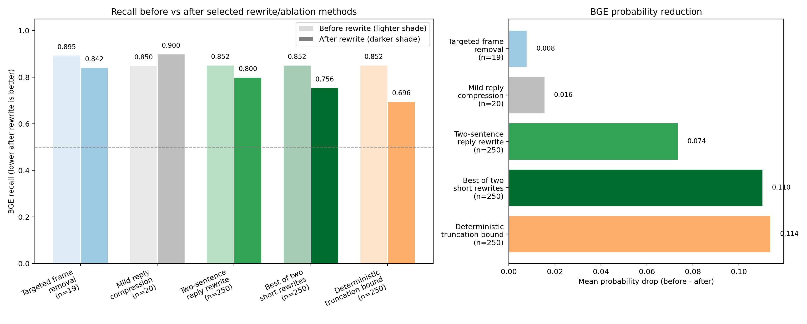

# BGE 改写消融实验分类汇总

## 1. 典型实验总表

| 类别 | 方式 | n | 概率下降 | recall变化 | 长度比例 | 判断 |
|---|---|---:|---:|---:|---:|---|
| 局部语义框架消融 | Targeted frame removal 移除权利/公共规范框架 | 19 | 0.008 | 0.895 -> 0.842 | 1.024 | 弱有效但不稳定 |
| 早期轻压缩策略 | Mild reply compression 轻度压缩为碎片化回复 | 20 | 0.016 | 0.850 -> 0.900 | 0.493 | 方向正确但力度不足 |
| 强压缩固定LLM策略 | Two-sentence reply rewrite 压缩为两句 thread reply | 250 | 0.074 | 0.852 -> 0.800 | 0.290 | 最优固定策略 |
| 强压缩detector-aware选优 | Best of two short rewrites 从两种短改写里选较优者 | 250 | 0.110 | 0.852 -> 0.756 | 0.316 | 最强LLM结果，但属检测器反馈上界 |
| 机械截断诊断基线 | Deterministic truncation bound 截断为前40词或前80词 | 250 | 0.114 | 0.852 -> 0.696 | 0.360 | 诊断上界，不推荐当改写策略 |

## 2. 结论

- **最优固定LLM策略**：Two-sentence reply rewrite，全文压成两句 thread reply，recall `0.852 -> 0.800`，平均概率下降 `0.074`。
- **最强LLM结果**：Best of two short rewrites，先生成两种短改写再选较优者，recall `0.852 -> 0.756`，平均概率下降 `0.110`。
- **诊断上界**：Deterministic truncation bound，把评论机械截断到前 40 或前 80 个词，recall `0.852 -> 0.696`，但它会粗暴丢失信息，不能当作语义保真改写。
- **基本没用的方向**：局部换框架、去事实核查、加个人视角、普通改写。它们没有打到 BGE 的核心抓手。

## 3. 图

读图注意：
- 左图中，同一种实验在“改写前”和“改写后”使用同一颜色系；浅色表示改写前，深色表示改写后。
- 横轴标签里的 `n=` 是该实验实际纳入比较的样本数，所以这 5 个实验并不是完全同样规模。
- Targeted frame removal 只是在局部语义改写组里表现最好，但它只有 `19` 个有效样本，不能和后面 `250` 个样本的全量实验等量齐观。

## 4. 分类解释

- **局部语义框架消融 / Targeted frame removal**：局部语义框架有一点影响，但概率下降太小，且有效样本少。
- **早期轻压缩策略 / Mild reply compression**：概率略降，但 recall 没降，说明普通压缩没有真正破坏 BGE 抓到的长篇解释结构。
- **强压缩固定LLM策略 / Two-sentence reply rewrite**：全量验证有效，说明短、碎、不完整的线程回复能稳定降低 BGE 检出。
- **强压缩detector-aware选优 / Best of two short rewrites**：效果最强的LLM方案，但用了检测器反馈，应表述为对抗压力测试，而不是普通自然改写。
- **机械截断诊断基线 / Deterministic truncation bound**：最能说明 BGE 对长度/完整解释结构敏感，但语义保真较差。
