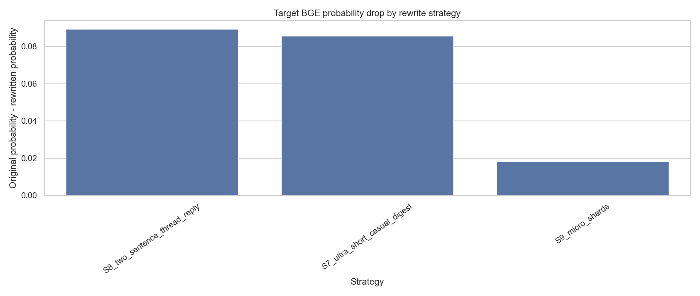
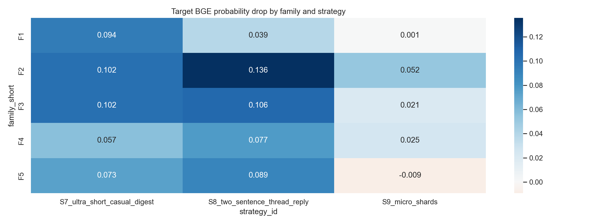
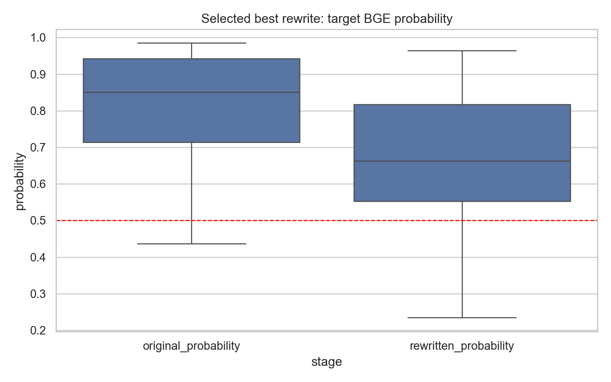

# BGE 改写策略搜索报告

## 1. 实验目的

本实验不再固定单一 treatment，而是为每条源评论生成多种候选改写，并用本地 BGE+LR 检测器真实打分，寻找能稳定降低检出概率的改写策略。

## 2. 设置

- 输入目录：`static_language/outputs/full_5family_50bot_3round_gpt54_20260601`
- 目标检测器：`lofo`
- 每个 family 源样本数：`10`
- LLM 模型：`gpt-5.4`
- 温度：`0.4`

## 3. 各策略效果

| Strategy | n | mean drop | before recall | after recall | flip rate | mean length ratio |
|---|---:|---:|---:|---:|---:|---:|
| `S8_two_sentence_thread_reply` | 50 | 0.089 | 0.900 | 0.880 | 0.060 | 0.276 |
| `S7_ultra_short_casual_digest` | 50 | 0.086 | 0.900 | 0.900 | 0.040 | 0.344 |
| `S9_micro_shards` | 50 | 0.018 | 0.900 | 0.940 | 0.020 | 0.531 |

## 4. 每条样本自动选择最优候选后的总体效果

- 样本数：`50`
- 平均概率：`0.808 -> 0.662`
- 平均概率下降：`0.146`
- recall：`0.900 -> 0.820`
- bot -> human 翻转率：`0.100`
- 平均长度比例：`0.341`

## 5. 图表

## 6. 解读

- 机械 `first_40/first_80` 是诊断基线，不应直接作为语义保真改写结论；它用于证明 BGE 对长度与完整解释结构敏感。
- 如果 LLM 压缩/碎片化策略接近或超过机械压缩的概率下降，就说明可以用更自然的改写方式降低检出，而不只是硬截断。
- 最优候选选择结果是上界估计，因为它使用了检测器反馈；正式论文中应将其表述为 detector-aware stress test，而不是自然生成策略。