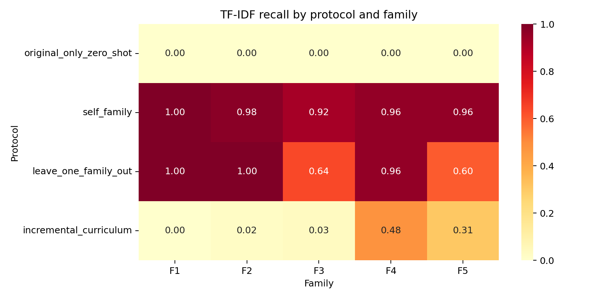
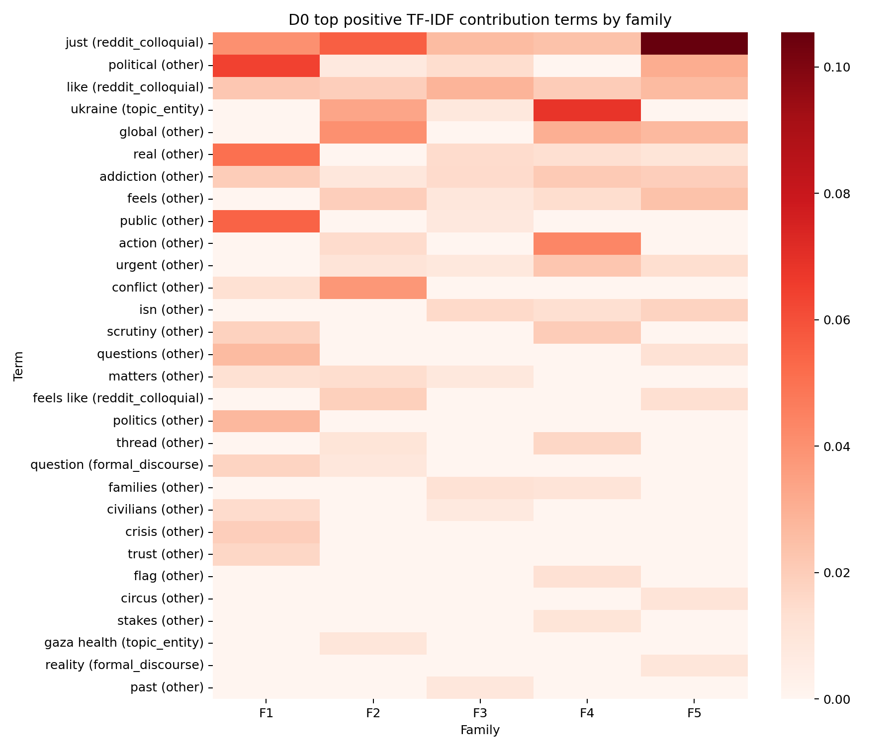
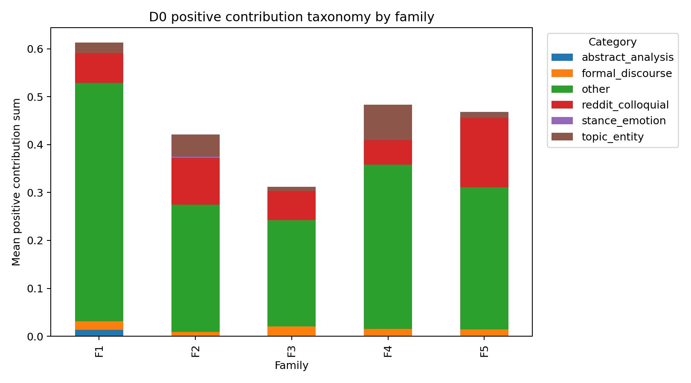
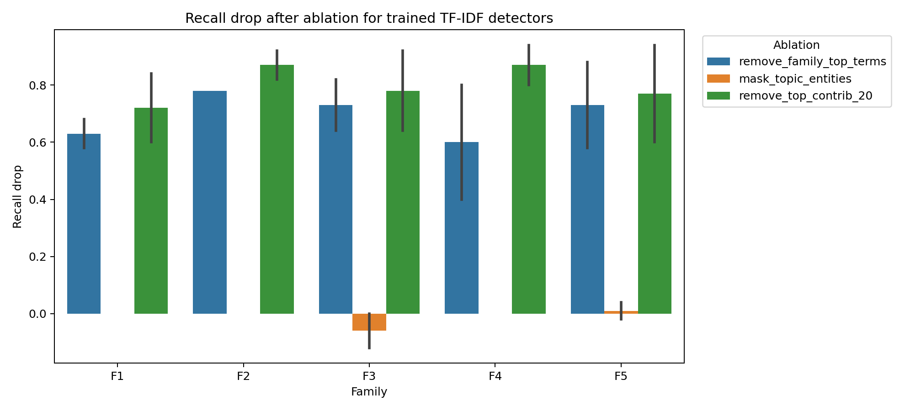
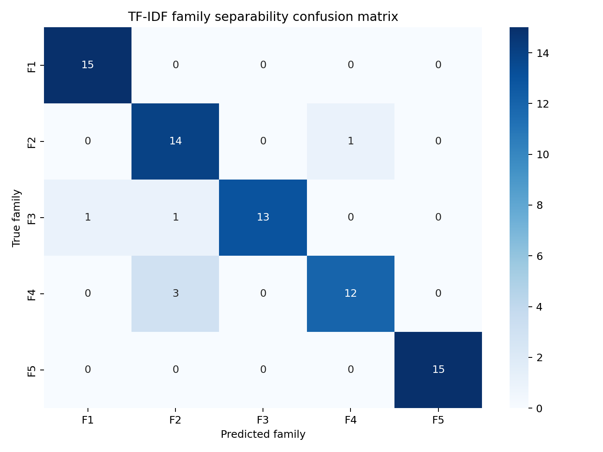
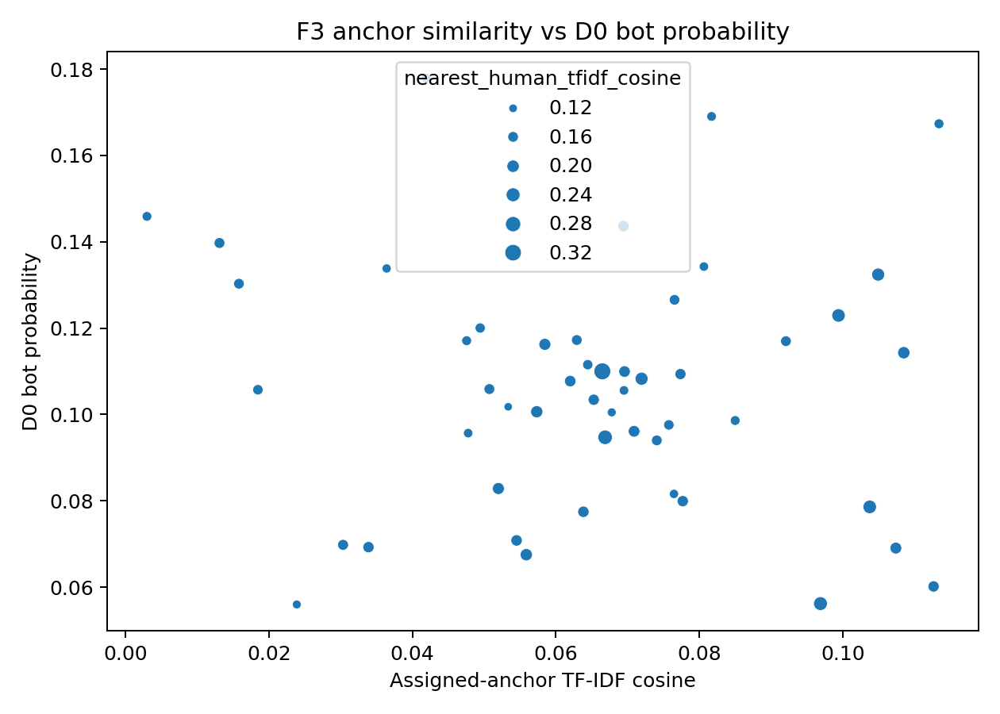

# TF-IDF 白盒指纹分析报告

- 输入目录：`static_language/outputs/full_5family_50bot_3round_gpt54_20260601`
- 输出目录：`static_language/outputs/full_5family_50bot_3round_gpt54_20260601/tfidf_fingerprint_analysis`
- 解释对象：`TfidfVectorizer(1-2gram) + LogisticRegression`
- 核心公式：`bot_logit = intercept + sum(tfidf(term) * coef(term))`

## 1. 总体结论

TF-IDF 检测不是黑箱。它主要通过每个 family 文本中反复出现的词项、短语和缺失的人类侧口语词来判断 bot。本报告把这些信号拆成三层：模型贡献项、指纹类别、反事实删除后的概率/召回变化。

## 2. 不同训练协议下的 TF-IDF 检出情况

| protocol                | family_short   |    recall |   mean_probability |
|:------------------------|:---------------|----------:|-------------------:|
| incremental_curriculum  | F1             | 0         |           0.228915 |
| incremental_curriculum  | F2             | 0.02      |           0.220912 |
| incremental_curriculum  | F3             | 0.0333333 |           0.253442 |
| incremental_curriculum  | F4             | 0.48      |           0.479218 |
| incremental_curriculum  | F5             | 0.308     |           0.417014 |
| leave_one_family_out    | F1             | 1         |           0.728757 |
| leave_one_family_out    | F2             | 1         |           0.72266  |
| leave_one_family_out    | F3             | 0.64      |           0.537687 |
| leave_one_family_out    | F4             | 0.96      |           0.750473 |
| leave_one_family_out    | F5             | 0.6       |           0.54963  |
| original_only_zero_shot | F1             | 0         |           0.228915 |
| original_only_zero_shot | F2             | 0         |           0.147576 |
| original_only_zero_shot | F3             | 0         |           0.106032 |
| original_only_zero_shot | F4             | 0         |           0.189339 |
| original_only_zero_shot | F5             | 0         |           0.220159 |
| self_family             | F1             | 1         |           0.750638 |
| self_family             | F2             | 0.98      |           0.722214 |
| self_family             | F3             | 0.92      |           0.636953 |
| self_family             | F4             | 0.96      |           0.715576 |
| self_family             | F5             | 0.96      |           0.683482 |

解释：`original_only_zero_shot` 是旧 TF-IDF 直接测新 family；`self_family` 是看见该 family 后训练；`leave_one_family_out` 是没看见目标 family 但看见其他 family；`incremental_curriculum` 是按顺序逐步加入。

## 3. D0 原始检测器下的正向指纹

D0 的 recall 为 0，说明旧原始 TF-IDF 没把这批新 family 判成 bot。但它仍给出了一些正向推力词项；这些词解释的是“旧模型眼里的残留 bot 倾向”，不是最终检出原因。

### F1

|   rank | term      | category          |   mean_contribution |     coef |
|-------:|:----------|:------------------|--------------------:|---------:|
|      1 | political | other             |           0.0638921 | 3.31641  |
|      2 | public    | other             |           0.05446   | 1.02618  |
|      3 | real      | other             |           0.0509472 | 0.873613 |
|      4 | just      | reddit_colloquial |           0.0401663 | 0.792725 |
|      5 | politics  | other             |           0.0273641 | 0.864233 |
|      6 | questions | other             |           0.0267172 | 1.086    |
|      7 | like      | reddit_colloquial |           0.0218318 | 0.577525 |
|      8 | addiction | other             |           0.0198942 | 0.247363 |
|      9 | crisis    | other             |           0.0195035 | 1.253    |
|     10 | scrutiny  | other             |           0.0184568 | 0.987163 |
|     11 | question  | formal_discourse  |           0.0174141 | 0.552379 |
|     12 | trust     | other             |           0.0166694 | 0.623388 |

### F2

|   rank | term        | category          |   mean_contribution |     coef |
|-------:|:------------|:------------------|--------------------:|---------:|
|      1 | just        | reddit_colloquial |          0.0557564  | 0.792725 |
|      2 | global      | other             |          0.040024   | 1.36383  |
|      3 | conflict    | other             |          0.0380675  | 1.95146  |
|      4 | ukraine     | topic_entity      |          0.0336373  | 1.30894  |
|      5 | feels       | other             |          0.0197265  | 0.944073 |
|      6 | like        | reddit_colloquial |          0.0196867  | 0.577525 |
|      7 | feels like  | reddit_colloquial |          0.0190925  | 0.821994 |
|      8 | action      | other             |          0.0147673  | 0.714899 |
|      9 | matters     | other             |          0.0143942  | 0.422025 |
|     10 | urgent      | other             |          0.0108089  | 0.627835 |
|     11 | thread      | other             |          0.0103998  | 0.193717 |
|     12 | gaza health | topic_entity      |          0.00958188 | 0.296014 |

### F3

|   rank | term      | category          |   mean_contribution |     coef |
|-------:|:----------|:------------------|--------------------:|---------:|
|      1 | like      | reddit_colloquial |          0.028808   | 0.577525 |
|      2 | just      | reddit_colloquial |          0.0261832  | 0.792725 |
|      3 | isn       | other             |          0.0154258  | 0.952629 |
|      4 | addiction | other             |          0.0149682  | 0.247363 |
|      5 | real      | other             |          0.0145904  | 0.873613 |
|      6 | political | other             |          0.0144159  | 3.31641  |
|      7 | families  | other             |          0.0122919  | 0.410829 |
|      8 | past      | other             |          0.00903921 | 0.432905 |
|      9 | feels     | other             |          0.00871591 | 0.944073 |
|     10 | ukraine   | topic_entity      |          0.00860467 | 1.30894  |
|     11 | matters   | other             |          0.00852774 | 0.422025 |
|     12 | watching  | other             |          0.00844094 | 0.570001 |

### F4

|   rank | term      | category          |   mean_contribution |     coef |
|-------:|:----------|:------------------|--------------------:|---------:|
|      1 | ukraine   | topic_entity      |           0.0686494 | 1.30894  |
|      2 | action    | other             |           0.0434474 | 0.714899 |
|      3 | global    | other             |           0.0301996 | 1.36383  |
|      4 | just      | reddit_colloquial |           0.0240375 | 0.792725 |
|      5 | urgent    | other             |           0.0223535 | 0.627835 |
|      6 | addiction | other             |           0.0211347 | 0.247363 |
|      7 | scrutiny  | other             |           0.0205893 | 0.987163 |
|      8 | like      | reddit_colloquial |           0.0201887 | 0.577525 |
|      9 | thread    | other             |           0.0166032 | 0.193717 |
|     10 | feels     | other             |           0.0142534 | 0.944073 |
|     11 | real      | other             |           0.0134936 | 0.873613 |
|     12 | isn       | other             |           0.0134393 | 0.952629 |

### F5

|   rank | term       | category          |   mean_contribution |     coef |
|-------:|:-----------|:------------------|--------------------:|---------:|
|      1 | just       | reddit_colloquial |           0.105449  | 0.792725 |
|      2 | political  | other             |           0.0312009 | 3.31641  |
|      3 | global     | other             |           0.0271217 | 1.36383  |
|      4 | like       | reddit_colloquial |           0.0264493 | 0.577525 |
|      5 | feels      | other             |           0.0240165 | 0.944073 |
|      6 | addiction  | other             |           0.0195873 | 0.247363 |
|      7 | isn        | other             |           0.0177591 | 0.952629 |
|      8 | urgent     | other             |           0.0140011 | 0.627835 |
|      9 | feels like | reddit_colloquial |           0.0132419 | 0.821994 |
|     10 | questions  | other             |           0.0120726 | 1.086    |
|     11 | circus     | other             |           0.0111153 | 0.6855   |
|     12 | real       | other             |           0.0106107 | 0.873613 |

## 4. Self-Family Detector 真正学到的 Family 指纹

这一节回答“为什么训练后 TF-IDF 能检出 F1-F5”。每个 detector 都用 original + 该 family 训练，因此 top terms 更接近该 family 的可学习指纹。

### F1 self detector

|   rank | term        | category          |   mean_contribution |     coef |
|-------:|:------------|:------------------|--------------------:|---------:|
|      1 | governments | other             |           0.0916674 | 1.18472  |
|      2 | real        | other             |           0.0838008 | 1.56081  |
|      3 | addiction   | other             |           0.0814718 | 1.23602  |
|      4 | public      | other             |           0.079781  | 1.63161  |
|      5 | line        | other             |           0.0749562 | 1.1252   |
|      6 | political   | other             |           0.0602556 | 3.31663  |
|      7 | access      | other             |           0.0591909 | 0.982138 |
|      8 | just        | reddit_colloquial |           0.054398  | 1.14371  |
|      9 | starts      | other             |           0.0464987 | 0.804641 |
|     10 | civilian    | other             |           0.0397159 | 0.837317 |
|     11 | civilians   | other             |           0.0387904 | 0.938265 |
|     12 | politics    | other             |           0.0365727 | 1.23066  |

### F2 self detector

|   rank | term       | category          |   mean_contribution |     coef |
|-------:|:-----------|:------------------|--------------------:|---------:|
|      1 | comparison | other             |           0.107648  | 1.28627  |
|      2 | just       | reddit_colloquial |           0.0890784 | 1.4209   |
|      3 | 2019       | other             |           0.0801423 | 1.03457  |
|      4 | weeks      | other             |           0.0766683 | 0.989348 |
|      5 | number     | other             |           0.053578  | 0.717901 |
|      6 | headline   | other             |           0.0524702 | 0.890983 |
|      7 | wording    | other             |           0.0518867 | 0.873407 |
|      8 | count      | other             |           0.0501541 | 0.806136 |
|      9 | actual     | other             |           0.0483057 | 0.787943 |
|     10 | exactly    | other             |           0.0434113 | 0.836964 |
|     11 | global     | other             |           0.041328  | 1.61781  |
|     12 | kids       | other             |           0.040649  | 0.760409 |

### F3 self detector

|   rank | term      | category          |   mean_contribution |     coef |
|-------:|:----------|:------------------|--------------------:|---------:|
|      1 | addiction | other             |           0.0784169 | 1.5018   |
|      2 | dead      | other             |           0.0778919 | 1.1062   |
|      3 | yeah      | reddit_colloquial |           0.0682242 | 0.985926 |
|      4 | kids      | other             |           0.0650137 | 1.10183  |
|      5 | dead kids | other             |           0.0506525 | 1.0939   |
|      6 | like      | reddit_colloquial |           0.048476  | 1.02014  |
|      7 | ugly      | other             |           0.0380616 | 0.912657 |
|      8 | hostages  | other             |           0.0371153 | 0.664544 |
|      9 | horrific  | other             |           0.0288849 | 0.788236 |
|     10 | just      | reddit_colloquial |           0.0287639 | 0.906537 |
|     11 | stuff     | other             |           0.0278397 | 0.639656 |
|     12 | dragging  | other             |           0.0274576 | 0.829504 |

### F4 self detector

|   rank | term             | category     |   mean_contribution |     coef |
|-------:|:-----------------|:-------------|--------------------:|---------:|
|      1 | addiction        | other        |           0.103369  | 1.50354  |
|      2 | thread           | other        |           0.0916144 | 1.34448  |
|      3 | flag             | other        |           0.0835488 | 1.22561  |
|      4 | flag protests    | other        |           0.0791796 | 1.16454  |
|      5 | ukraine          | topic_entity |           0.0769419 | 1.73043  |
|      6 | action           | other        |           0.0739419 | 1.43876  |
|      7 | ceasefire aid    | other        |           0.0595892 | 0.976432 |
|      8 | kids             | other        |           0.0586878 | 0.910166 |
|      9 | correction       | other        |           0.0477417 | 0.860486 |
|     10 | wording          | other        |           0.0427136 | 0.924656 |
|     11 | small correction | other        |           0.0426017 | 0.802264 |
|     12 | protests         | other        |           0.0395043 | 0.737413 |

### F5 self detector

|   rank | term      | category          |   mean_contribution |     coef |
|-------:|:----------|:------------------|--------------------:|---------:|
|      1 | just      | reddit_colloquial |           0.332019  | 2.61225  |
|      2 | addiction | other             |           0.0921709 | 1.37949  |
|      3 | actually  | other             |           0.0715263 | 0.864864 |
|      4 | timeline  | other             |           0.0661776 | 1.09793  |
|      5 | numbers   | other             |           0.0625763 | 1.09934  |
|      6 | actual    | other             |           0.0612812 | 0.946408 |
|      7 | overseas  | other             |           0.0501432 | 0.967833 |
|      8 | like      | reddit_colloquial |           0.0371921 | 0.834087 |
|      9 | global    | other             |           0.0317055 | 1.64446  |
|     10 | exactly   | other             |           0.031533  | 0.723217 |
|     11 | feels     | other             |           0.0311367 | 1.26075  |
|     12 | political | other             |           0.0297615 | 3.19984  |

## 5. 指纹类别分布

| family_short   | category          |   term_count |   mean_positive_contribution |
|:---------------|:------------------|-------------:|-----------------------------:|
| F1             | other             |           33 |                   0.497936   |
| F1             | reddit_colloquial |            2 |                   0.0619981  |
| F1             | topic_entity      |            2 |                   0.0222196  |
| F1             | formal_discourse  |            1 |                   0.0174141  |
| F1             | abstract_analysis |            2 |                   0.0137466  |
| F2             | other             |           31 |                   0.265616   |
| F2             | reddit_colloquial |            4 |                   0.0981625  |
| F2             | topic_entity      |            3 |                   0.0460146  |
| F2             | formal_discourse  |            1 |                   0.00883675 |
| F2             | stance_emotion    |            1 |                   0.00274576 |
| F3             | other             |           32 |                   0.222118   |
| F3             | reddit_colloquial |            3 |                   0.060851   |
| F3             | formal_discourse  |            4 |                   0.0204758  |
| F3             | topic_entity      |            1 |                   0.00860467 |
| F4             | other             |           32 |                   0.34296    |
| F4             | topic_entity      |            2 |                   0.0731978  |
| F4             | reddit_colloquial |            3 |                   0.0518769  |
| F4             | formal_discourse  |            3 |                   0.0151435  |
| F5             | other             |           33 |                   0.297164   |
| F5             | reddit_colloquial |            3 |                   0.14514    |
| F5             | formal_discourse  |            2 |                   0.0140484  |
| F5             | topic_entity      |            2 |                   0.0117882  |

图：

## 6. 反事实删除：哪些指纹真正有用

| protocol             | family_short   | ablation                |   original_recall |   ablated_recall |   recall_drop |   mean_probability_drop |
|:---------------------|:---------------|:------------------------|------------------:|-----------------:|--------------:|------------------------:|
| leave_one_family_out | F1             | remove_top_contrib_20   |              1    |             0.16 |          0.84 |             0.318147    |
| leave_one_family_out | F1             | remove_family_top_terms |              1    |             0.32 |          0.68 |             0.260834    |
| leave_one_family_out | F1             | mask_topic_entities     |              1    |             1    |          0    |            -0.0100787   |
| leave_one_family_out | F1             | mask_abstract_terms     |              1    |             1    |          0    |             0.00178148  |
| leave_one_family_out | F1             | mask_template_phrases   |              1    |             1    |          0    |             3.72665e-05 |
| leave_one_family_out | F1             | truncate_length_matched |              1    |             1    |          0    |             0.00585273  |
| leave_one_family_out | F2             | remove_top_contrib_20   |              1    |             0.08 |          0.92 |             0.378362    |
| leave_one_family_out | F2             | remove_family_top_terms |              1    |             0.22 |          0.78 |             0.277094    |
| leave_one_family_out | F2             | mask_topic_entities     |              1    |             1    |          0    |             0.00495877  |
| leave_one_family_out | F2             | mask_abstract_terms     |              1    |             1    |          0    |             0           |
| leave_one_family_out | F2             | mask_template_phrases   |              1    |             1    |          0    |             0.000114463 |
| leave_one_family_out | F2             | truncate_length_matched |              1    |             1    |          0    |             0           |
| leave_one_family_out | F3             | remove_family_top_terms |              0.64 |             0    |          0.64 |             0.217611    |
| leave_one_family_out | F3             | remove_top_contrib_20   |              0.64 |             0    |          0.64 |             0.306753    |
| leave_one_family_out | F3             | mask_abstract_terms     |              0.64 |             0.64 |          0    |             0.000258567 |
| leave_one_family_out | F3             | mask_template_phrases   |              0.64 |             0.64 |          0    |             0           |
| leave_one_family_out | F3             | truncate_length_matched |              0.64 |             0.64 |          0    |             0.00405573  |
| leave_one_family_out | F3             | mask_topic_entities     |              0.64 |             0.76 |         -0.12 |            -0.0292246   |
| leave_one_family_out | F4             | remove_top_contrib_20   |              0.96 |             0.16 |          0.8  |             0.358016    |
| leave_one_family_out | F4             | remove_family_top_terms |              0.96 |             0.56 |          0.4  |             0.233737    |
| leave_one_family_out | F4             | mask_topic_entities     |              0.96 |             0.96 |          0    |             0.00809532  |
| leave_one_family_out | F4             | mask_abstract_terms     |              0.96 |             0.96 |          0    |             0           |
| leave_one_family_out | F4             | mask_template_phrases   |              0.96 |             0.96 |          0    |             0           |
| leave_one_family_out | F4             | truncate_length_matched |              0.96 |             0.96 |          0    |             0           |
| leave_one_family_out | F5             | remove_top_contrib_20   |              0.6  |             0    |          0.6  |             0.322613    |
| leave_one_family_out | F5             | remove_family_top_terms |              0.6  |             0.02 |          0.58 |             0.232892    |
| leave_one_family_out | F5             | mask_abstract_terms     |              0.6  |             0.6  |          0    |             0.00156102  |
| leave_one_family_out | F5             | mask_template_phrases   |              0.6  |             0.6  |          0    |             0           |
| leave_one_family_out | F5             | truncate_length_matched |              0.6  |             0.6  |          0    |            -9.92331e-07 |
| leave_one_family_out | F5             | mask_topic_entities     |              0.6  |             0.62 |         -0.02 |             0.00172229  |
| self_family          | F1             | remove_top_contrib_20   |              1    |             0.4  |          0.6  |             0.290771    |
| self_family          | F1             | remove_family_top_terms |              1    |             0.42 |          0.58 |             0.25086     |
| self_family          | F1             | mask_topic_entities     |              1    |             1    |          0    |            -0.00599546  |
| self_family          | F1             | mask_abstract_terms     |              1    |             1    |          0    |             0.00496982  |
| self_family          | F1             | mask_template_phrases   |              1    |             1    |          0    |            -0.000134351 |
| self_family          | F1             | truncate_length_matched |              1    |             1    |          0    |             0.00541185  |
| self_family          | F2             | remove_top_contrib_20   |              0.98 |             0.16 |          0.82 |             0.353426    |
| self_family          | F2             | remove_family_top_terms |              0.98 |             0.2  |          0.78 |             0.288722    |
| self_family          | F2             | mask_topic_entities     |              0.98 |             0.98 |          0    |             0.0125831   |
| self_family          | F2             | mask_abstract_terms     |              0.98 |             0.98 |          0    |             0           |
| self_family          | F2             | mask_template_phrases   |              0.98 |             0.98 |          0    |            -0.000328655 |
| self_family          | F2             | truncate_length_matched |              0.98 |             0.98 |          0    |             0           |
| self_family          | F3             | remove_top_contrib_20   |              0.92 |             0    |          0.92 |             0.30715     |
| self_family          | F3             | remove_family_top_terms |              0.92 |             0.1  |          0.82 |             0.228452    |
| self_family          | F3             | mask_topic_entities     |              0.92 |             0.92 |          0    |            -0.0140656   |
| self_family          | F3             | mask_abstract_terms     |              0.92 |             0.92 |          0    |             0.000248804 |
| self_family          | F3             | mask_template_phrases   |              0.92 |             0.92 |          0    |             0           |
| self_family          | F3             | truncate_length_matched |              0.92 |             0.92 |          0    |             0.00695565  |
| self_family          | F4             | remove_top_contrib_20   |              0.96 |             0.02 |          0.94 |             0.374593    |
| self_family          | F4             | remove_family_top_terms |              0.96 |             0.16 |          0.8  |             0.292308    |
| self_family          | F4             | mask_topic_entities     |              0.96 |             0.96 |          0    |             0.00934837  |
| self_family          | F4             | mask_abstract_terms     |              0.96 |             0.96 |          0    |             0           |
| self_family          | F4             | mask_template_phrases   |              0.96 |             0.96 |          0    |             0           |
| self_family          | F4             | truncate_length_matched |              0.96 |             0.96 |          0    |             0           |
| self_family          | F5             | remove_top_contrib_20   |              0.96 |             0.02 |          0.94 |             0.368203    |
| self_family          | F5             | remove_family_top_terms |              0.96 |             0.08 |          0.88 |             0.274475    |
| self_family          | F5             | mask_topic_entities     |              0.96 |             0.92 |          0.04 |             0.00153564  |
| self_family          | F5             | mask_abstract_terms     |              0.96 |             0.96 |          0    |             0.0013395   |
| self_family          | F5             | mask_template_phrases   |              0.96 |             0.96 |          0    |             0           |
| self_family          | F5             | truncate_length_matched |              0.96 |             0.96 |          0    |             0.000490781 |

关键读法：如果 `remove_top_contrib_20` 或 `remove_family_top_terms` 让 recall 大幅下降，说明这些词项就是 TF-IDF 真正在用的指纹；如果只删 topic/template 不下降，说明检测不是单纯靠话题或模板短语。

## 7. Family Separability

- 只用 TF-IDF 区分 F1-F5 的准确率：`0.920`。
- 如果该值较高，说明 family 本身存在可学习的生成指纹；检测器可能学到 family 机制，而不只是 human/bot 差异。

## 8. F3 Anchor 专项

- D0 平均 bot probability：`0.106`
- assigned-anchor TF-IDF cosine：`0.065`
- nearest-human TF-IDF cosine：`0.172`
- human-side protective term rate：`0.0536`

解释口径：F3 的目标应表述为让文本靠近 human pool 或 anchor 风格区域，而不是逐条复刻指定 anchor。如果 F3 仍被检出，优先查看它是否保留正向 bot 词项，或缺少 human-side 口语/碎片表达。

## 9. 输出文件说明

- `sample_level_attributions.csv`：逐样本、逐词项贡献。
- `family_top_positive_terms.csv`：各 family 最推高 bot 概率的词项。
- `family_top_negative_terms.csv`：各 family 中最像 human 的词项。
- `ablation_probability_drop.csv`：逐样本反事实删除后的概率变化。
- `ablation_recall_drop_by_family.csv`：逐 family 反事实删除后的 recall 变化。
- `family_separability_matrix.csv`：F1-F5 互相分类混淆矩阵。
- `f3_anchor_missingness_analysis.csv`：F3 anchor 相似度与缺失 human-side 指标。