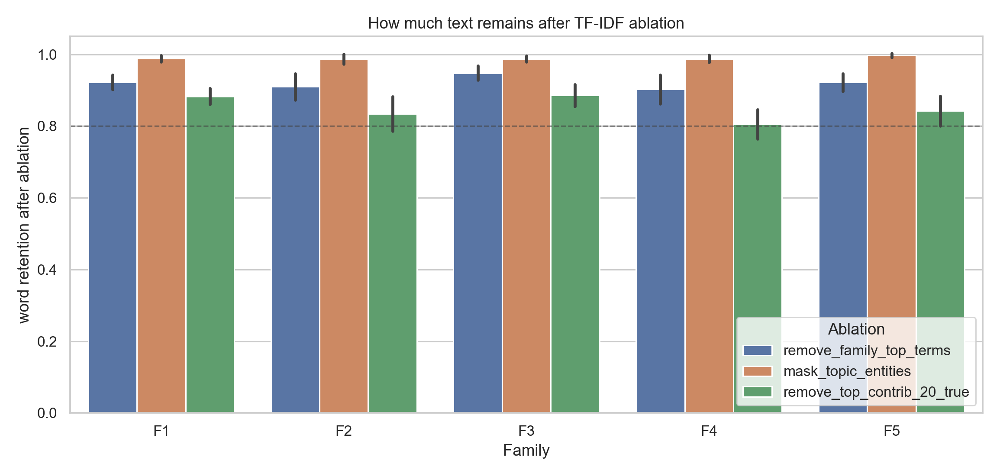
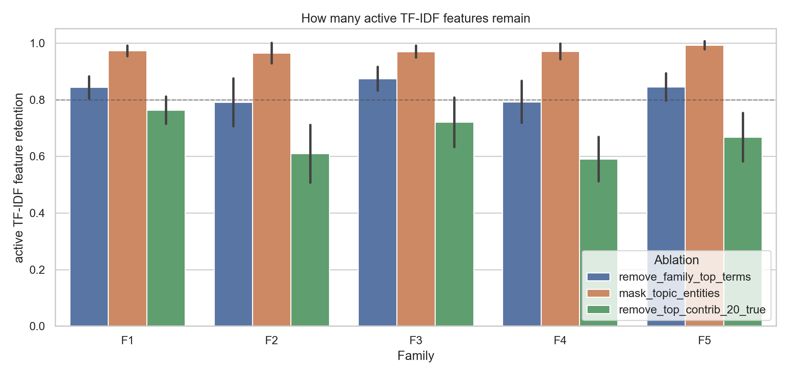
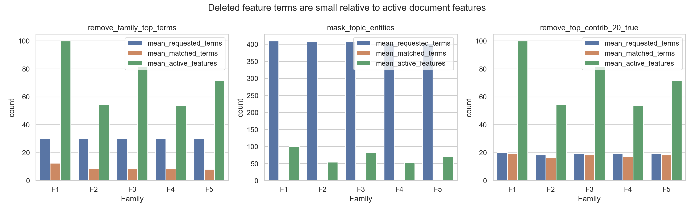
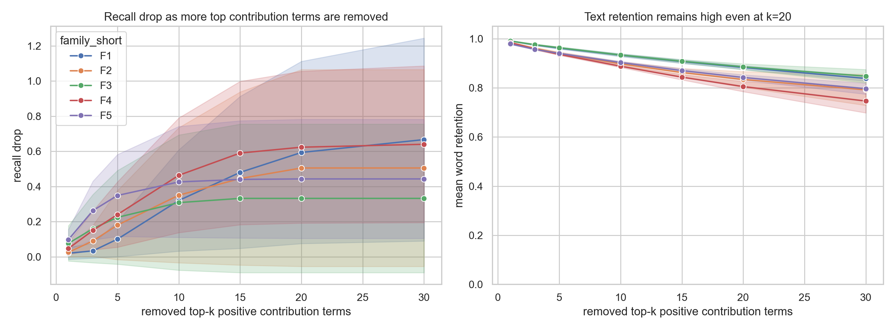
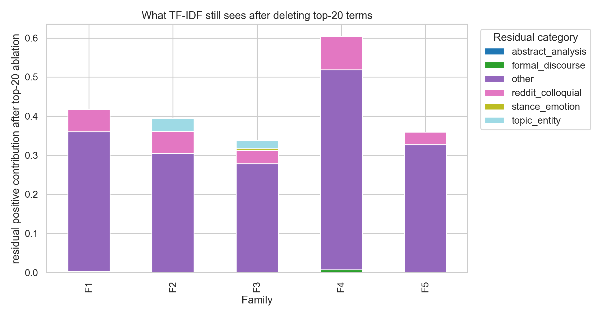

# TF-IDF 反事实删除规模有效性审计报告

- 输入目录：`static_language/outputs/full_5family_50bot_3round_gpt54_20260601`
- 输出目录：`static_language/outputs/full_5family_50bot_3round_gpt54_20260601/tfidf_fingerprint_analysis/ablation_scope_validation`
- detector 总数：`26`，其中本文主图使用非 zero-shot 的 trained detectors：`25`
- TF-IDF 最大词表：`10000`，实际每个 detector 词表接近该上限。

## 1. 为什么要补这个审计

上一张图说明：删除 TF-IDF 正向贡献词后，F1-F5 的 bot recall 大幅下降。评审很可能追问：是不是因为删得太多，文本被破坏了，所以检测器当然失效？本报告专门回答这个问题。

这里的删除单位不是“整段语义”或“整条评论”，而是 TF-IDF vectorizer 中的 unigram/bigram feature term。`remove_top_contrib_20_true` 表示对每个样本重新计算真实 top-20 bot 正向贡献词项后删除；如果某些词项是 bigram，只删除该短语；如果词项在文本中没有实际匹配，则不会删除原文。

> 重要修正：旧 `remove_top_contrib_20` 图名沿用了 top-20 命名，但旧缓存的 sample attribution 默认只保存 15 项。本审计重新训练同一批 detector，并从模型内部计算 top-1/3/5/10/15/20/30，因此下面的 top-20 是真实 top-20。

## 2. top-20 到底删了多少

对 `remove_top_contrib_20_true`，平均每个 bot 用户文档约有：

- 原始词数：`171.1`
- 删除后词数：`147.8`
- 词数保留率：`0.850`
- 原始活跃 TF-IDF 特征数：`72.2`
- 删除后活跃 TF-IDF 特征数：`50.6`
- 活跃特征保留率：`0.670`
- 请求删除词项数：`19.3`
- 实际匹配到文本里的词项数：`17.9`
- 实际匹配词项 / 原始活跃特征：`0.273`

这说明 top-20 删除不是把文本清空。它通常只命中一小部分原词和一部分活跃 TF-IDF 特征；删除后文本仍有大部分词，vectorizer 也仍能看到过半活跃特征。换句话说，recall 下降不是因为“什么都没剩”，而是因为被删掉的少量特征正好是 LR 权重最依赖的 bot-side 指纹。

## 3. 删除词项和文本总规模的对比

下图把三种主要 ablation 的请求删除词项、实际匹配词项、原文活跃 TF-IDF 特征放在一起。注意：词表规模约为 10,000，单个用户文档通常只有几十到一百个左右的活跃 feature；top-20 在词表层面非常小，在单文档活跃 feature 层面也不是全部清空。

| family_short   | ablation                   |   mean_word_retained_ratio |   mean_active_feature_retained_ratio |   mean_requested_terms |   mean_matched_terms |   mean_matched_terms_over_active_features |   mean_probability_drop |
|:---------------|:---------------------------|---------------------------:|-------------------------------------:|-----------------------:|---------------------:|------------------------------------------:|------------------------:|
| F1             | mask_topic_entities        |                   0.98848  |                             0.972852 |               409.333  |              2.22667 |                                0.021423   |             -0.0074527  |
| F1             | remove_family_top_terms    |                   0.922607 |                             0.843699 |                30      |             12.5133  |                                0.127005   |              0.200747   |
| F1             | remove_top_contrib_20_true |                   0.882847 |                             0.763665 |                20      |             19.1933  |                                0.199653   |              0.286303   |
| F2             | mask_topic_entities        |                   0.987443 |                             0.964797 |               407      |              1.07    |                                0.0208027  |              0.00764934 |
| F2             | remove_family_top_terms    |                   0.910297 |                             0.791065 |                30      |              8.44    |                                0.154843   |              0.185212   |
| F2             | remove_top_contrib_20_true |                   0.834044 |                             0.609482 |                18.285  |             16.235   |                                0.310436   |              0.278249   |
| F3             | mask_topic_entities        |                   0.987947 |                             0.969884 |               406.8    |              1.944   |                                0.0231812  |             -0.0183729  |
| F3             | remove_family_top_terms    |                   0.948317 |                             0.874356 |                30      |              8.32    |                                0.102296   |              0.144847   |
| F3             | remove_top_contrib_20_true |                   0.885655 |                             0.720537 |                19.38   |             18.34    |                                0.244293   |              0.2344     |
| F4             | mask_topic_entities        |                   0.98809  |                             0.970963 |               403      |              1.2     |                                0.0213679  |              0.00914332 |
| F4             | remove_family_top_terms    |                   0.902748 |                             0.792809 |                30      |              8.24333 |                                0.154206   |              0.203062   |
| F4             | remove_top_contrib_20_true |                   0.805149 |                             0.590903 |                19.2533 |             17.2467  |                                0.333685   |              0.337719   |
| F5             | mask_topic_entities        |                   0.997112 |                             0.992434 |               402.857  |              0.42    |                                0.00655099 |              0.001776   |
| F5             | remove_family_top_terms    |                   0.922157 |                             0.845278 |                30      |              8.18286 |                                0.117345   |              0.194365   |
| F5             | remove_top_contrib_20_true |                   0.842205 |                             0.667574 |                19.5229 |             18.3371  |                                0.278166   |              0.297019   |

## 4. top-k 敏感性：20 个词是不是武断过多

如果 top-20 太激进，那么应该看到只有 k=20 或 k=30 时 recall 才突然崩掉，并且词数保留率大幅下降。实际更合理的读法是：随着 k 从 1 增加到 30，recall drop 逐步上升；到 k=20 时文本仍保留较高比例。这表明我们删除的是一组高杠杆指纹，而不是靠粗暴破坏文本取胜。

| family_short   |   recall_drop |   word_retained |   active_feature_retained |
|:---------------|--------------:|----------------:|--------------------------:|
| F1             |      0.593333 |        0.882847 |                  0.763665 |
| F2             |      0.505    |        0.834044 |                  0.609482 |
| F3             |      0.332    |        0.885655 |                  0.720537 |
| F4             |      0.623333 |        0.805149 |                  0.590903 |
| F5             |      0.442857 |        0.842205 |                  0.667574 |

## 5. 删除后还剩什么

删除 top-20 后，检测器仍然能看到剩余话题词、普通口语词、情绪词、以及其他 bigram。下面列的是删除后仍有正向 bot 贡献的 residual terms。它们解释了为什么 ablation 后 recall 不是全部归零：文本还在，信号也还在，只是最强的那部分被拿掉了。

| family_short   |   rank | term          | category          |   mean_residual_contribution |   seen_in_detectors |
|:---------------|-------:|:--------------|:------------------|-----------------------------:|--------------------:|
| F1             |      1 | people        | reddit_colloquial |                   0.0219723  |                   1 |
| F1             |      2 | right defend  | other             |                   0.0173733  |                   1 |
| F1             |      3 | governments   | other             |                   0.0168807  |                   1 |
| F1             |      4 | exactly       | other             |                   0.0164957  |                   1 |
| F1             |      5 | conditions    | other             |                   0.0161781  |                   1 |
| F1             |      6 | civilians     | other             |                   0.015119   |                   1 |
| F1             |      7 | does          | other             |                   0.0137184  |                   1 |
| F1             |      8 | yes           | other             |                   0.0123472  |                   1 |
| F2             |      1 | 40 000        | other             |                   0.0202282  |                   1 |
| F2             |      2 | save children | other             |                   0.0186972  |                   1 |
| F2             |      3 | people        | reddit_colloquial |                   0.0184174  |                   1 |
| F2             |      4 | doing lot     | other             |                   0.0159907  |                   2 |
| F2             |      5 | yeah          | reddit_colloquial |                   0.0154329  |                   1 |
| F2             |      6 | weeks         | other             |                   0.0150932  |                   1 |
| F2             |      7 | number        | other             |                   0.0145414  |                   1 |
| F2             |      8 | comparison    | other             |                   0.0130562  |                   1 |
| F3             |      1 | getting       | other             |                   0.00989519 |                   2 |
| F3             |      2 | just          | reddit_colloquial |                   0.00983819 |                   1 |
| F3             |      3 | say           | other             |                   0.00889039 |                   1 |
| F3             |      4 | obviously     | other             |                   0.00786077 |                   2 |
| F3             |      5 | yeah          | reddit_colloquial |                   0.00729433 |                   1 |
| F3             |      6 | gets          | other             |                   0.00715383 |                   1 |
| F3             |      7 | lot           | other             |                   0.00686748 |                   1 |
| F3             |      8 | ceasefire     | other             |                   0.00675029 |                   2 |
| F4             |      1 | people        | reddit_colloquial |                   0.0229667  |                   2 |
| F4             |      2 | post          | other             |                   0.0132762  |                   4 |
| F4             |      3 | doing lot     | other             |                   0.0126231  |                   4 |
| F4             |      4 | yeah          | reddit_colloquial |                   0.0125123  |                   2 |
| F4             |      5 | ceasefire aid | other             |                   0.011351   |                   1 |
| F4             |      6 | lot work      | other             |                   0.0111948  |                   4 |
| F4             |      7 | getting       | other             |                   0.00953469 |                   2 |
| F4             |      8 | campaign      | other             |                   0.00934555 |                   3 |
| F5             |      1 | people        | reddit_colloquial |                   0.00666274 |                   3 |
| F5             |      2 | like          | reddit_colloquial |                   0.00604204 |                   2 |
| F5             |      3 | completely    | other             |                   0.0053367  |                   1 |
| F5             |      4 | stuff         | other             |                   0.00506107 |                   1 |
| F5             |      5 | bank          | other             |                   0.00500888 |                   1 |
| F5             |      6 | deals         | other             |                   0.00488784 |                   5 |
| F5             |      7 | bit           | other             |                   0.00487358 |                   4 |
| F5             |      8 | shouldn       | other             |                   0.00457714 |                   1 |

## 6. 删除后文本示例

完整示例见 `SCOPE_TEXT_EXAMPLES_AFTER_TOP20_CN.md` 和 `scope_text_examples_after_top20.csv`。下面摘几条可以直接检查：

### F1 / f1_original_architecture_001

- 词数保留率：`0.886`；活跃特征保留率：`0.791`；概率下降：`0.328`
- 删除词项：`institutions; governments; investigate; incitement; addiction; questions; civilians; politics; treating; partisan; loyalty; public; crisis; starts; symbol; legal; feels; line; just; prop`

原文节选：

> This is the part that should alarm people beyond this war. When a state starts treating sympathy for civilians, or even dissent from the war line, as suspect speech, the guardrails are already slipping. Maybe some cases involve actual incitement. Fine, investigate that narrowly. But mass arrests over social posts is how democracies teach citizens to self-censor first and ask legal questions later. Bad precedent. Very bad one. This is one of those places where the country keeps failing a very basic test. If there is evidence of crimes or ...

删除后节选：

> This is the part that should alarm people beyond this war. When a state sympathy for , or even dissent from the war , as suspect speech, the guardrails are already slipping. Maybe some cases involve actual . Fine, that narrowly. But mass arrests over social posts is how democracies teach citizens to self-censor first and ask later. Bad precedent. Very bad one. This is one of those places where the country keeps failing a very basic test. If there is evidence of crimes or influence peddling, that. Fine. But ...

### F1 / f1_original_architecture_038

- 词数保留率：`0.884`；活跃特征保留率：`0.753`；概率下降：`0.330`
- 删除词项：`consequences; institutions; politics; treating; violence; question; security; justice; matters; exactly; leaders; quickly; public; caveat; trust; clear; trend; lines; avoid; just`

原文节选：

> This is one of the better trend lines in Asia right now. South Korea and Japan do not have to suddenly trust each other to see that the security math has changed with China, North Korea, and a shakier world economy. Better ties also help the US alliance system, which matters more than people admit. Small caveat though, these resets are fragile, and domestic politics or old historical disputes can still knock them off course pretty quickly. That sounds more dramatic than it is. Mixed reactions usually just mean the ...

删除后节选：

> This is one of the better in Asia right now. South Korea and Japan do not have to suddenly each other to see that the math has changed with China, North Korea, and a shakier world economy. Better ties also help the US alliance system, which more than people admit. Small though, these resets are fragile, and domestic or old historical disputes can still knock them off course pretty . That sounds more dramatic than it is. Mixed reactions usually mean the idea was rolled out poorly or not fully ...

### F2 / f2_tfidf_informed_language_035

- 词数保留率：`0.811`；活跃特征保留率：`0.509`；概率下降：`0.311`
- 删除词项：`campaign material; gaza health; ukraine war; feels like; addiction; plainly; instead; numbers; global; family; sober; turns; just; grim`

原文节选：

> Maybe I’m missing something, but how is this Russia-Ukraine war news? Feels like the tag’s just wrong. That’s my gripe as well. The 3 weeks part is bad enough on its own, but if they’re comparing Gaza health ministry numbers to yearly global verified counts elsewhere, they need to just say that plainly in the article. Otherwise the whole thread turns into people arguing over the wording instead of the dead kids, which is grim. Using someone’s addiction as campaign material is grim, honestly. You can dislike the family and ...

删除后节选：

> Maybe I’m missing something, but how is this Russia- news? the tag’s wrong. That’s my gripe as well. The 3 weeks part is bad enough on its own, but if they’re comparing ministry to yearly verified counts elsewhere, they need to say that in the article. Otherwise the whole thread into people arguing over the wording of the dead kids, which is . Using someone’s as is , honestly. You can dislike the and still admit dragging a person for getting is low.

### F2 / f2_tfidf_informed_language_002

- 词数保留率：`0.718`；活跃特征保留率：`0.371`；概率下降：`0.302`
- 删除词项：`somebody; honestly; exactly; mystery; ordered; urgent; public; phrase; cities; expect; starts; bleak; apart; like; grim; yeah; wall; look; bit; low`

原文节选：

> Yeah, "less urgent" sounds like a desk phrase, sorry. If cities are still getting hit, what exactly got less urgent here apart from US stock running low? Six years and still no mastermind named? That's grim, honestly. For a case this public you'd expect more than that by now. Yeah, that’s the bit. If nobody can name who ordered it after six years, it starts to look less like a mystery and more like somebody hit a wall on purpose. Pretty bleak either way.

删除后节选：

> , "less " sounds a desk , sorry. If are still getting hit, what got less here from US stock running ? Six years and still no mastermind named? That's , . For a case this you'd more than that by now. , that’s the . If nobody can name who it after six years, it to less a and more hit a on purpose. Pretty either way.

### F3 / f3_human_anchor_local_tfidf_006

- 词数保留率：`0.871`；活跃特征保留率：`0.611`；概率下降：`0.247`
- 删除词项：`substance abuse; state starts; battlefield; suddenly; somebody; dragging; matters; updates; problem; issues; shift; stuff; makes; point; line; ugly; like`

原文节选：

> This part should scare people more than the battlefield updates. When the state starts dragging in people at home over stuff they said, that's a rotten line to cross. I get why people are furious right now, few paragraphs later and all anyone hears is revenge. But a country does not stay normal by making people lower their voice and watch every word. Some people absolutely are doing that. Not everyone, but you can see the shift now: substance abuse quits being treated like an illness and suddenly it becomes, ...

删除后节选：

> This part should scare people more than the . When the in people at home over they said, that's a rotten to cross. I get why people are furious right now, few paragraphs later and all anyone hears is revenge. But a country does not stay normal by making people lower their voice and watch every word. Some people absolutely are doing that. Not everyone, but you can see the now: quits being treated an illness and it becomes, "there you go, he's trash." I get your main though. If ...

## 7. 可用于论文的严谨表述

可以写：

> We audit the ablation scope to ensure the recall drop is not caused by wholesale text destruction. Removing the per-sample top-20 positive TF-IDF contribution terms retains most original words and active TF-IDF features. Nevertheless, recall drops substantially, indicating that trained TF-IDF detectors rely on a small set of high-leverage family-specific lexical features rather than broad semantic understanding.

中文解释就是：这组实验不是证明“删光文本以后模型不会识别”，而是证明“少量高贡献词项对 trained TF-IDF 的检出非常关键”。这正是白盒指纹实验要说明的机制。

## 8. 输出文件

- `scope_ablation_sample_stats.csv`：逐样本删除规模、词数、活跃特征、概率变化。
- `scope_ablation_recall_by_detector.csv`：逐 detector / family / ablation 的 recall drop 与保留率。
- `scope_topk_sensitivity.csv`：top-k 从 1 到 30 的敏感性曲线数据。
- `scope_residual_terms_after_top20.csv`：top-20 删除后残留正向贡献词。
- `scope_text_examples_after_top20.csv`：删除前后文本示例。