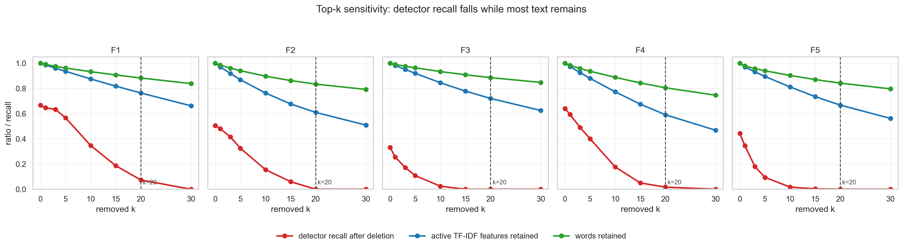
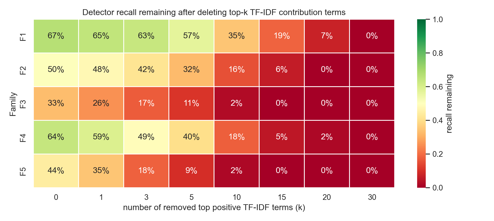
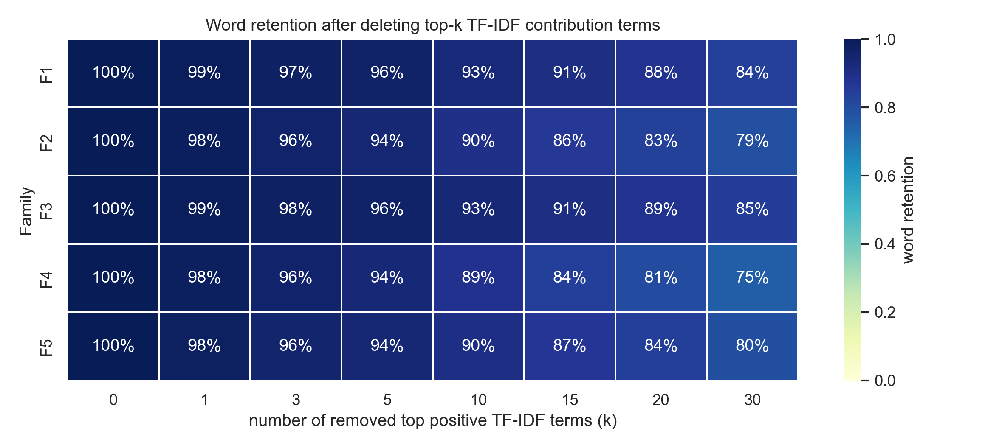

# top-k 敏感性图重画说明

上一版 top-k 曲线把 recall drop 和 retention 放在一张普通折线图里，图例和误差条太多，不够直观。新版改成三个更容易读的问题：

1. 删到每个 k 后，detector 的 recall 还剩多少？
2. 删到每个 k 后，原文词数还剩多少？
3. k=20 是否只是任意挑的点，还是处在一条连续变化曲线上？

## 推荐用于论文正文的图

优先用这张：

读法：每个 family 一个小面板，红线是删除 top-k 后 detector recall，绿线是词数保留率，蓝线是活跃 TF-IDF 特征保留率。虚线标出 k=20。如果红线明显下降、绿线仍然较高，就说明 recall 下降不是因为文本被删光，而是因为少数高贡献词项被拿掉了。

## 推荐用于附录的两张 heatmap

这张直接看 recall 还剩多少。颜色越红，说明删掉 top-k 后检测器越难检出。

这张直接看文本还剩多少。和上一张一起读，就能支撑论文里的因果解释：top-k 删除让 recall 下跌，但词数仍大多保留。

## k=20 的具体数值

| family_short   |   original_recall |   ablated_recall |   recall_drop |   word_retained |   active_feature_retained |
|:---------------|------------------:|-----------------:|--------------:|----------------:|--------------------------:|
| F1             |          0.666667 |        0.0733333 |      0.593333 |        0.882847 |                  0.763665 |
| F2             |          0.505    |        0         |      0.505    |        0.834044 |                  0.609482 |
| F3             |          0.332    |        0         |      0.332    |        0.885655 |                  0.720537 |
| F4             |          0.64     |        0.0166667 |      0.623333 |        0.805149 |                  0.590903 |
| F5             |          0.442857 |        0         |      0.442857 |        0.842205 |                  0.667574 |

## 建议替换原表述

不要只说“删除 top-20 后 recall 下降”。建议写成：

> We vary the number of removed positive TF-IDF contribution terms from k=1 to k=30. The detector recall decreases smoothly as k increases, while most original words remain even at k=20. This shows that k=20 is not an arbitrary destructive setting; it lies on a continuous sensitivity curve and removes a small set of high-leverage lexical fingerprints.

中文含义：k=20 不是拍脑袋选的极端删除，而是 top-k 敏感性曲线上的一个中等偏强干预点。它足以移除高杠杆 TF-IDF 指纹，但没有把文本整体清空。