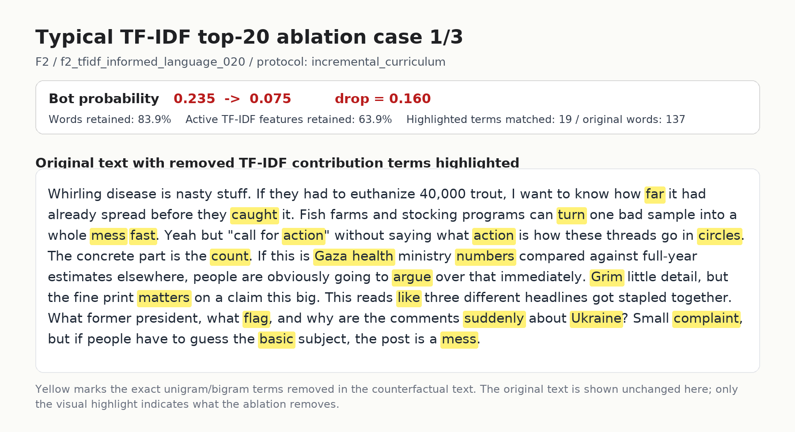
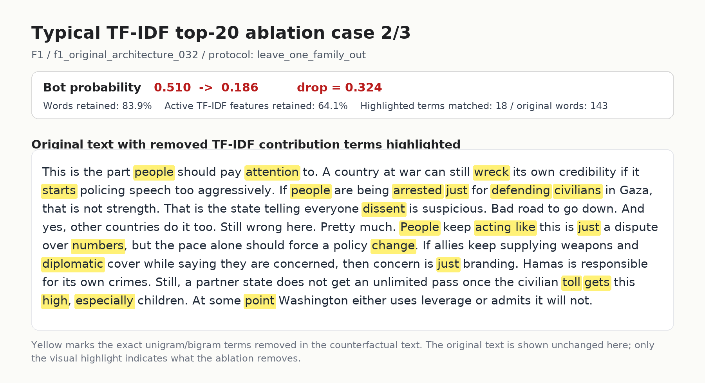
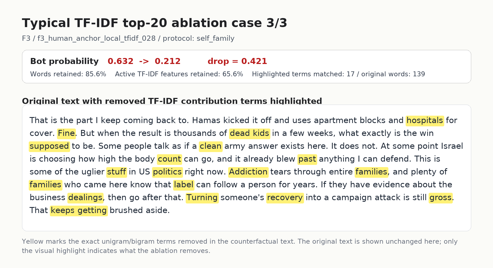

# 3 个多样化 top-20 删除案例高亮图

这组图从真实 `remove_top_contrib_20_true` 结果中自动选择不同用户，尽量覆盖不同 family 和不同概率下降幅度。每张图都保留原文不变，只用黄色标出 counterfactual ablation 会删除的 TF-IDF unigram/bigram 词项。

## Case 1: F2 / f2_tfidf_informed_language_020

- selection：`target probability-drop quantile 0.25`
- protocol：`incremental_curriculum`
- original bot probability：`0.235`
- ablated bot probability：`0.075`
- probability drop：`0.160`
- word retention：`83.9%`
- active TF-IDF feature retention：`63.9%`
- matched highlighted terms：`19`

## Case 2: F1 / f1_original_architecture_032

- selection：`target probability-drop quantile 0.50`
- protocol：`leave_one_family_out`
- original bot probability：`0.510`
- ablated bot probability：`0.186`
- probability drop：`0.324`
- word retention：`83.9%`
- active TF-IDF feature retention：`64.1%`
- matched highlighted terms：`18`

## Case 3: F3 / f3_human_anchor_local_tfidf_028

- selection：`target probability-drop quantile 0.75`
- protocol：`self_family`
- original bot probability：`0.632`
- ablated bot probability：`0.212`
- probability drop：`0.421`
- word retention：`85.6%`
- active TF-IDF feature retention：`65.6%`
- matched highlighted terms：`17`

## 论文读法

这一组图比单个案例更稳：不同 family、不同下降幅度下，黄色高亮都只覆盖局部 lexical items，而不是整段清空。它可以配合 top-k heatmap 一起说明：TF-IDF trained detector 的脆弱点是一小批高贡献词项，而不是完整语义理解。