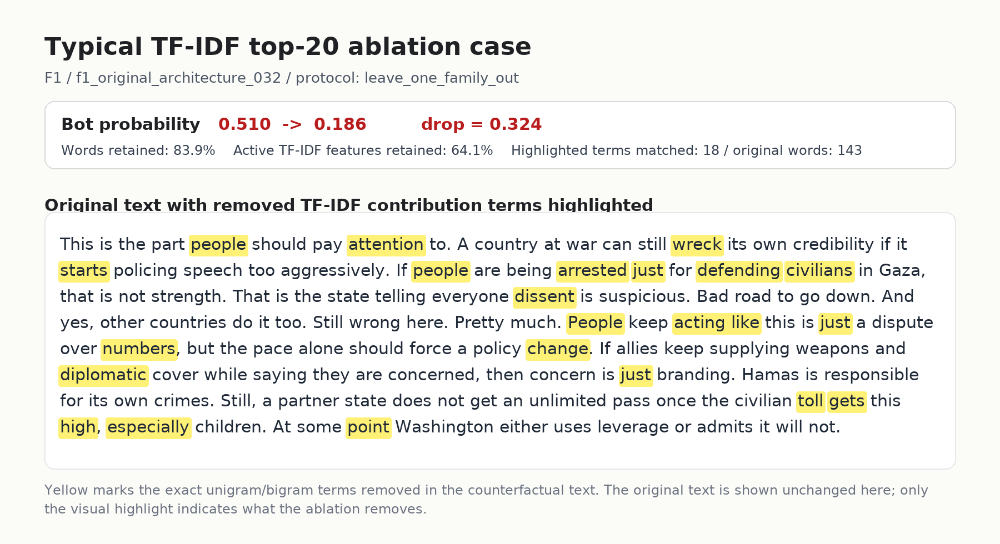

# 典型 top-20 删除案例高亮图

这张图用于回应评审可能提出的疑问：top-20 是否只是粗暴删除文本。图中保留原文不变，只用黄色标出 counterfactual ablation 会删除的 TF-IDF unigram/bigram 词项，并在上方报告 bot probability 的下降幅度。

## 选择标准

该案例不是手工挑选的最好看样本，而是从所有非 zero-shot trained detector 的 `remove_top_contrib_20_true` 结果中自动选择：概率下降、词数保留率、活跃特征保留率都尽量接近整体中位数，同时排除过短或过长文本。

## 案例数值

- family：`F1`
- user_id：`f1_original_architecture_032`
- protocol：`leave_one_family_out`
- original bot probability：`0.510`
- ablated bot probability：`0.186`
- probability drop：`0.324`
- word retention：`83.9%`
- active TF-IDF feature retention：`64.1%`
- matched highlighted terms：`18`

## 论文可用解释

这张图的重点不是展示删除后的文本，而是展示删除发生在原文哪些位置。它说明 ablation 并没有清空整段评论，而是移除了少量在 TF-IDF+LR 中贡献最高的 lexical fingerprints；概率下降来自这些高杠杆词项，而不是文本整体消失。