# 静态文本扩展实验详细图文分析报告

生成日期：2026-06-03

## 0. 报告定位

这份报告分析的是静态 family 文本实验结果，不重新生成 bot，也不调用 LLM。它的目标不是再报告一个单点 accuracy，而是解释检测器在跨 family 泛化、topic shortcut、anchor 对齐、family 指纹和 OOD 识别上的行为。

本轮五个实验分别是：

- Leave-One-Family-Out 正式化
- Semantic-Cluster-Controlled Detection
- Anchor Similarity Evaluation
- Family Separability
- Static Text OOD Detection

## 1. 面向研究目标的总览结论

| 研究问题 | 当前证据 | 结论 |
|---|---|---|
| 跨 family 泛化是否稳定？ | LOFO 中 TF-IDF 最难 `F5=0.600`，BGE 最难 `F5=0.760` | 泛化不均匀，F3/F5 更能暴露检测器短板 |
| 是否存在 topic shortcut？ | 旧 BGE 语义簇实验 k=12 下 TF-IDF recall drop `0.017`，BGE drop `0.090`；新帖子归类 topic control 下 TF-IDF drop `-0.004` | 评论语义簇会带来分布压力，但严格帖子话题控制后 TF-IDF 仍主要依赖话题之外的人机文本差异 |
| anchor 是否有效？ | F3 BGE nearest-human cosine `0.771`，风格 z-L2 `2.710` | F3 更接近 human pool，但不是逐条 anchor 复刻 |
| family 是否真的有差异？ | TF-IDF family 分类 acc `1.000`，BGE acc `0.950` | family 指纹很强，生成策略可被反向识别 |
| OOD 能否补充分类器？ | 最强 `bge_knn_k20_distance`，mean AUROC `0.648` | OOD 有中等信号，kNN 比 supervised probability 更可靠 |

## 2. 实验一：Leave-One-Family-Out 正式化

### 2.1 实验目的

LOFO 回答的问题是：如果一个 bot family 完全没有进入训练集，检测器是否还能检出它。这个协议比按顺序逐步加入 family 更干净，因为它不依赖 curriculum 顺序。

### 2.2 核心结果

```text
heldout_family_short  BGE+LR  TF-IDF+LR
                  F1    1.00       1.00
                  F2    0.84       1.00
                  F3    0.86       0.64
                  F4    1.00       0.96
                  F5    0.76       0.60
```

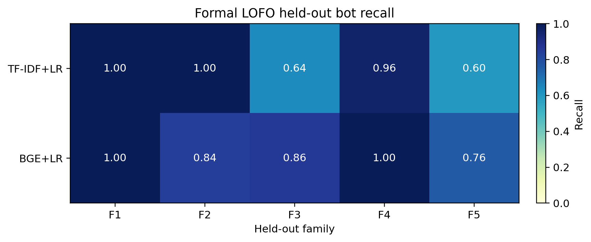

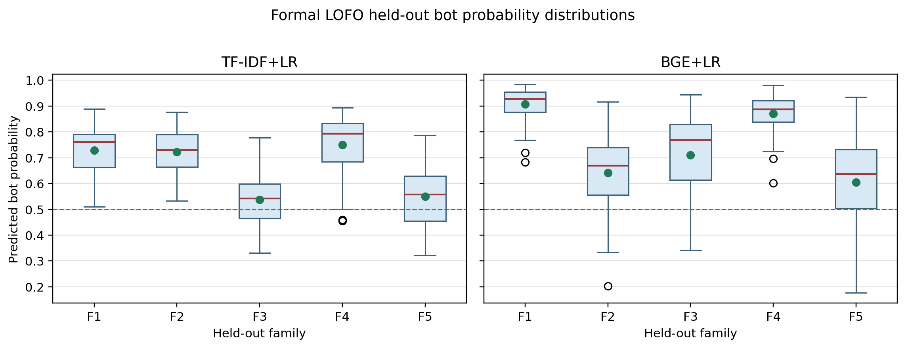

### 2.3 解读

- TF-IDF 对 F1/F2 几乎完全检出，但对 F3 和 F5 明显下降；其中最难的是 `F5`，recall `0.600`。
- BGE 整体更稳，但仍然在 `F5` 上最低，recall `0.760`。
- original_test 上性能仍然高，说明 LOFO 低 recall 不是模型整体崩溃，而是 held-out family 的跨分布问题。
- 这对我们的 benchmark 目标很关键：如果只做随机切分，会掩盖这种 family-level 泛化差异。

## 3. 实验二：Semantic-Cluster-Controlled Detection

### 3.1 实验目的

这个实验检查检测器是否利用了话题捷径。若 bot 和 human 讨论的话题分布不同，TF-IDF 尤其可能把 topic words 当成 bot 信号。

### 3.2 Topic-Matched 结果

```text
 k    model  matched_total_retained  baseline_global_test_bot_recall  controlled_matched_test_bot_recall  bot_recall_drop_vs_global  bot_recall_drop_vs_uncontrolled_matched_test
 8 tfidf_lr                     494                         0.942857                            0.866667                   0.076190                                     -0.100000
 8   bge_lr                     494                         0.960000                            0.900000                   0.060000                                     -0.033333
12 tfidf_lr                     602                         0.942857                            0.925926                   0.016931                                     -0.074074
12   bge_lr                     602                         0.960000                            0.870370                   0.089630                                      0.018519
16 tfidf_lr                     420                         0.942857                            0.821429                   0.121429                                     -0.107143
16   bge_lr                     420                         0.960000                            0.785714                   0.174286                                      0.000000
```

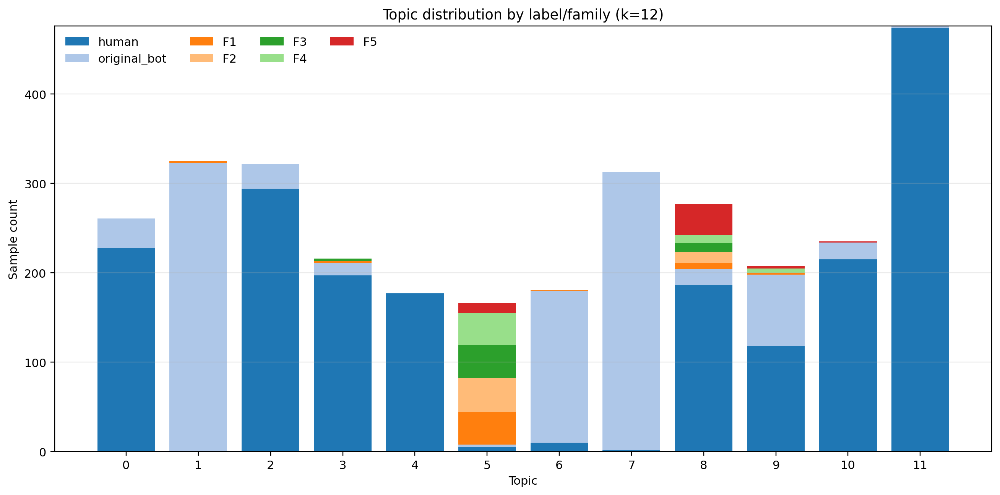

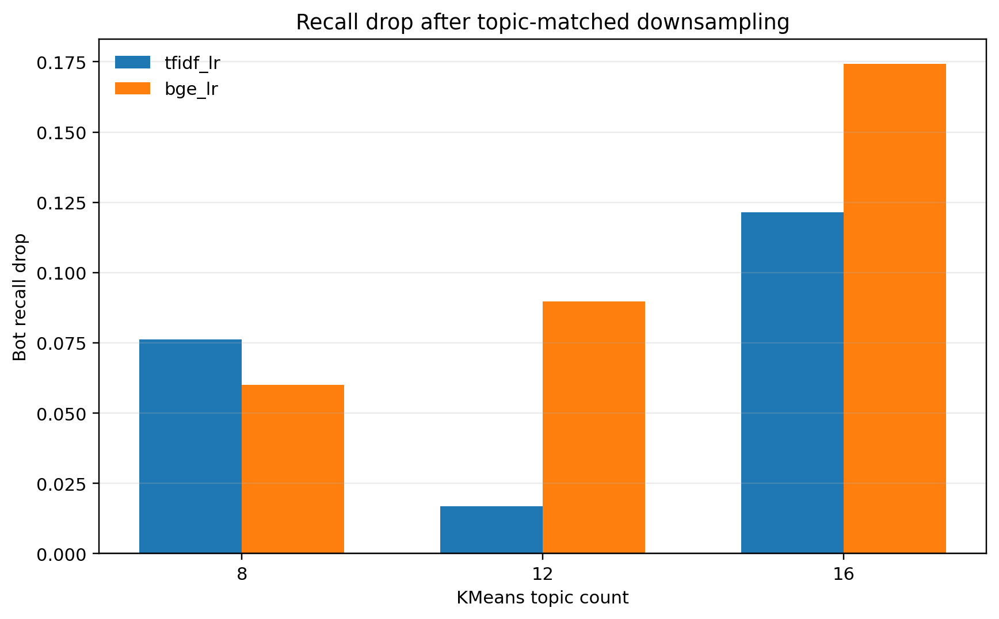

### 3.3 Within-topic 与 Leave-one-topic-out

Within-topic 状态：
```text
 k    model              status  n
 8   bge_lr                  ok  6
 8   bge_lr skipped_small_topic  2
 8 tfidf_lr                  ok  6
 8 tfidf_lr skipped_small_topic  2
12   bge_lr                  ok  7
12   bge_lr skipped_small_topic  5
12 tfidf_lr                  ok  7
12 tfidf_lr skipped_small_topic  5
16   bge_lr                  ok  8
16   bge_lr skipped_small_topic  8
16 tfidf_lr                  ok  8
16 tfidf_lr skipped_small_topic  8
```

Leave-one-topic-out 状态：
```text
 k    model              status  n
 8   bge_lr                  ok  7
 8   bge_lr skipped_small_topic  1
 8 tfidf_lr                  ok  7
 8 tfidf_lr skipped_small_topic  1
12   bge_lr                  ok 11
12   bge_lr skipped_small_topic  1
12 tfidf_lr                  ok 11
12 tfidf_lr skipped_small_topic  1
16   bge_lr                  ok 15
16   bge_lr skipped_small_topic  1
16 tfidf_lr                  ok 15
16 tfidf_lr skipped_small_topic  1
```


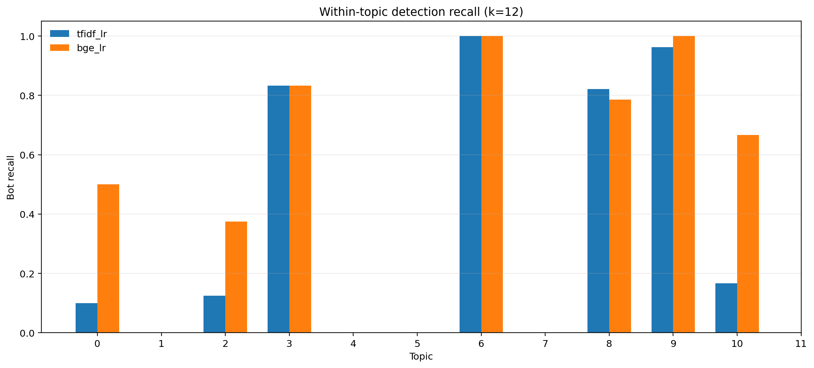

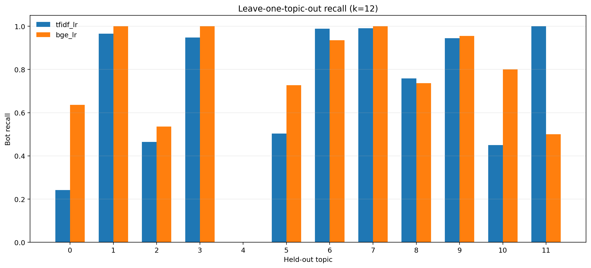

### 3.4 解读

- k=12 `tfidf_lr`：全局 bot recall `0.943`，topic-controlled recall `0.926`，drop `0.017`。
- k=12 `bge_lr`：全局 bot recall `0.960`，topic-controlled recall `0.870`，drop `0.090`。
- k=16 时 drop 更大，说明 topic 粒度越细，样本保留越少，检测更容易受局部 topic 分布影响。
- 但 k=12 下 TF-IDF drop 很小，说明它不只是靠 topic；BGE drop 更明显，可能因为 topic-matched 子集改变了语义空间里的可分边界。
- 有些 topic 被跳过是合理的，尤其 topic 4 出现 human 多、bot 少或无 bot 的情况；这本身也是数据分布偏斜证据。

## 4. 实验三：Anchor Similarity Evaluation

### 4.1 实验目的

Anchor 实验不是直接问“能不能骗过检测器”，而是问我们设计的 anchor 对齐机制是否真的把 bot 文本推近 human 文本区域。

### 4.2 Anchor linkage audit

```text
family_short  generated_users  generated_comments  user_anchor_linkage_coverage  comment_anchor_linkage_coverage                           analysis_mode                                                                                                    audit_note
          F1               50                 145                           0.0                              0.0 nearest_human_pool_fallback_no_manifest   No specified anchor manifest rows for this family; only nearest original human pool metrics are applicable.
          F2               50                 150                           0.0                              0.0 nearest_human_pool_fallback_no_manifest   No specified anchor manifest rows for this family; only nearest original human pool metrics are applicable.
          F3               50                 144                           1.0                              1.0 assigned_anchor_plus_nearest_human_pool All generated users have resolved specified anchors; assigned-anchor and nearest-pool metrics are both valid.
          F4               50                 150                           0.0                              0.0 nearest_human_pool_fallback_no_manifest   No specified anchor manifest rows for this family; only nearest original human pool metrics are applicable.
          F5               50                 149                           0.0                              0.0 nearest_human_pool_fallback_no_manifest   No specified anchor manifest rows for this family; only nearest original human pool metrics are applicable.
```

### 4.3 Family-level similarity

```text
family_short  n_comments  nearest_anchor_tfidf_cosine_mean  assigned_anchor_tfidf_cosine_mean  nearest_human_bge_cosine_mean  human_centroid_style_z_l2_mean  detector_tfidf_bot_probability_mean  detector_bge_bot_probability_mean
          F1         145                          0.114263                                NaN                       0.756167                        3.654835                             0.235591                           0.585172
          F2         150                          0.132372                                NaN                       0.743129                        2.902752                             0.148297                           0.119719
          F3         144                          0.133240                           0.034196                       0.771129                        2.710402                             0.107199                           0.184218
          F4         150                          0.131615                                NaN                       0.733969                        3.290292                             0.193383                           0.383057
          F5         149                          0.124336                                NaN                       0.710304                        3.438062                             0.215842                           0.239468
```

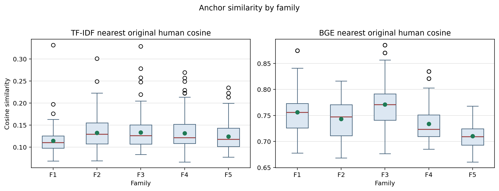

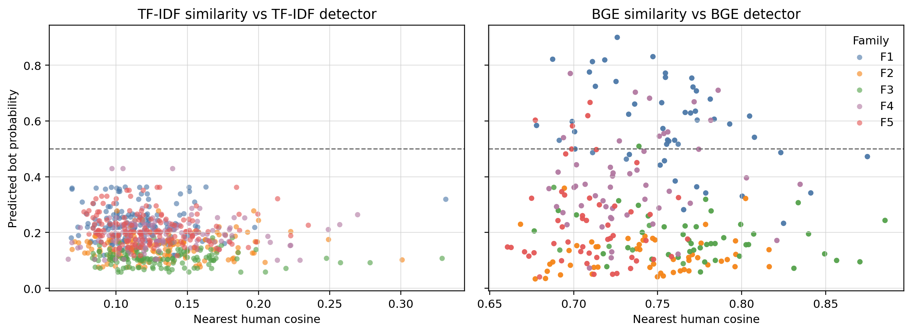

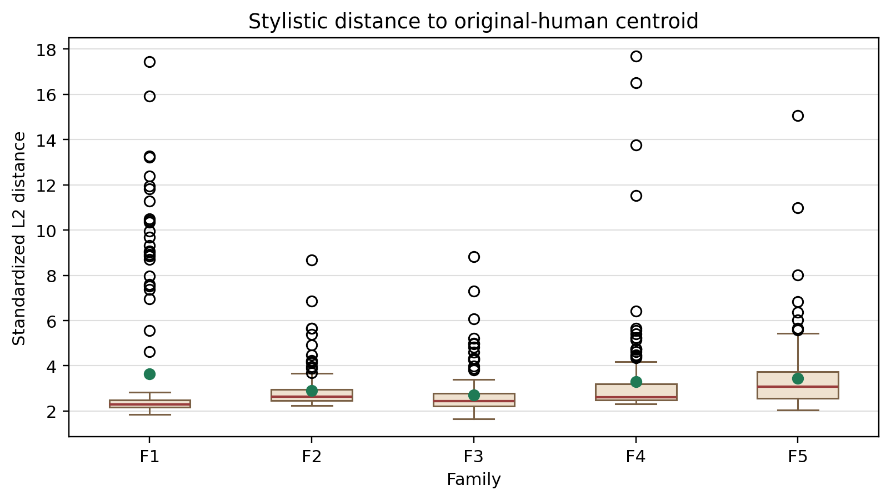

### 4.4 解读

- F3 的 comment anchor linkage coverage 为 `1.000`，说明 F3 的 anchor 追踪链条完整。
- F3 的 nearest-human BGE cosine 为 `0.771`，五个 family 中最高；human centroid style z-L2 为 `2.710`，五个 family 中最低。
- 但 F3 assigned-anchor TF-IDF cosine 只有 `0.034`，低于 nearest-human TF-IDF cosine `0.133`。这说明 F3 不是逐条复刻指定 anchor 的表层词，而是整体进入更接近 human pool 的语义/风格区域。
- 这个结果对论文表述很重要：应说“anchor alignment improves human-pool proximity”，而不是“bot imitates exact anchor language”。

## 5. 实验四：Family Separability

### 5.1 实验目的

这个实验把任务改成只在 F1-F5 bot 文本中预测 family 类别。它衡量的是生成策略是否留下 family fingerprint。

### 5.2 Test 指标

```text
               model feature     lr_mode  accuracy  macro_f1
tfidf_multinomial_lr   tfidf multinomial      1.00  1.000000
        tfidf_ovr_lr   tfidf         ovr      1.00  1.000000
  bge_multinomial_lr     bge multinomial      0.95  0.949804
          bge_ovr_lr     bge         ovr      0.95  0.949804
```

### 5.3 Confusion matrix

TF-IDF confusion matrix：
```text
true_family  F1  F2  F3  F4  F5
         F1   8   0   0   0   0
         F2   0   8   0   0   0
         F3   0   0   8   0   0
         F4   0   0   0   8   0
         F5   0   0   0   0   8
```

BGE confusion matrix：
```text
true_family  F1  F2  F3  F4  F5
         F1   8   0   0   0   0
         F2   1   7   0   0   0
         F3   0   0   8   0   0
         F4   0   0   1   7   0
         F5   0   0   0   0   8
```


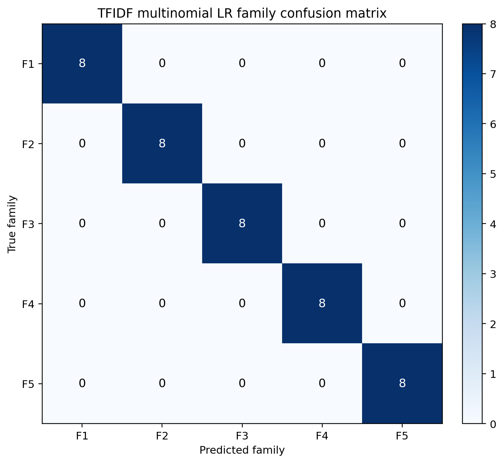

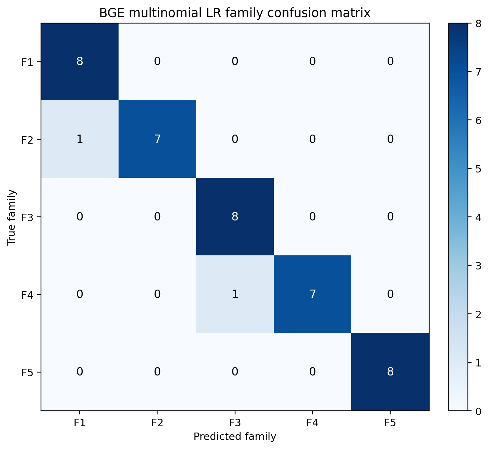

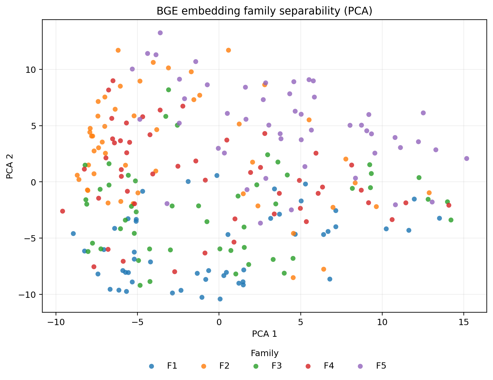

### 5.4 解读

- TF-IDF 在 test 上达到 1.000 accuracy/macro-F1，说明五个 family 在表层词汇/短语空间里极易区分。
- BGE 达到 0.950 accuracy，只有 F2->F1 和 F4->F3 的少量混淆，说明语义空间里 family 也很清楚。
- 这不是单纯的正面结果。它说明我们确实制造了 family 多样性，但也制造了强 family 指纹。后续 benchmark 需要把 family identity 视作一种潜在泄漏或可学习捷径。

## 6. 实验五：Static Text OOD Detection

### 6.1 实验目的

OOD 实验问的是：即使分类器不能稳定检出未见 family，距离式或异常检测是否能发现它们偏离 known distribution。

### 6.2 Method summary

```text
                        method     method_category                                                                               score_direction  is_supervised_proxy  mean_auroc_ood_vs_id  median_auroc_ood_vs_id  mean_auprc_ood  mean_score_gap_heldout_minus_id
     bge_centroid_min_distance semi_supervised_ood                       larger score = farther from nearest known human/bot centroid = more OOD                False              0.586913                0.623129        0.137066                         0.007792
       bge_centroid_bot_margin semi_supervised_ood larger score = farther from known bot centroid than human centroid = more bot-family OOD-like                False              0.426295                0.470000        0.101625                        -0.000529
           bge_knn_k5_distance    unsupervised_ood               larger score = larger mean distance to 5 nearest known-train samples = more OOD                False              0.646036                0.659588        0.162562                         0.069889
          bge_knn_k10_distance    unsupervised_ood              larger score = larger mean distance to 10 nearest known-train samples = more OOD                False              0.646525                0.656014        0.162347                         0.069940
          bge_knn_k20_distance    unsupervised_ood              larger score = larger mean distance to 20 nearest known-train samples = more OOD                False              0.647959                0.654124        0.162223                         0.070135
          bge_isolation_forest    unsupervised_ood                               larger score = lower IsolationForest normality score = more OOD                False              0.579520                0.562407        0.133397                         0.001534
tfidf_lr_bot_probability_proxy    supervised_proxy              larger score = higher supervised bot probability used as OOD proxy; not pure OOD                 True              0.489031                0.529202        0.111720                        -0.052180
  bge_lr_bot_probability_proxy    supervised_proxy              larger score = higher supervised bot probability used as OOD proxy; not pure OOD                 True              0.578901                0.547663        0.136760                         0.056633
```

### 6.3 Scenario mean AUROC

```text
           scenario                         method  auroc_ood_vs_id
         lofo_known   bge_lr_bot_probability_proxy         0.591699
         lofo_known           bge_knn_k20_distance         0.587699
         lofo_known           bge_knn_k10_distance         0.583552
         lofo_known            bge_knn_k5_distance         0.580994
         lofo_known      bge_centroid_min_distance         0.548163
         lofo_known           bge_isolation_forest         0.545857
         lofo_known tfidf_lr_bot_probability_proxy         0.503560
         lofo_known        bge_centroid_bot_margin         0.418363
original_only_known            bge_knn_k5_distance         0.711079
original_only_known           bge_knn_k10_distance         0.709498
original_only_known           bge_knn_k20_distance         0.708220
original_only_known      bge_centroid_min_distance         0.625663
original_only_known           bge_isolation_forest         0.613182
original_only_known   bge_lr_bot_probability_proxy         0.566103
original_only_known tfidf_lr_bot_probability_proxy         0.474502
original_only_known        bge_centroid_bot_margin         0.434227
```

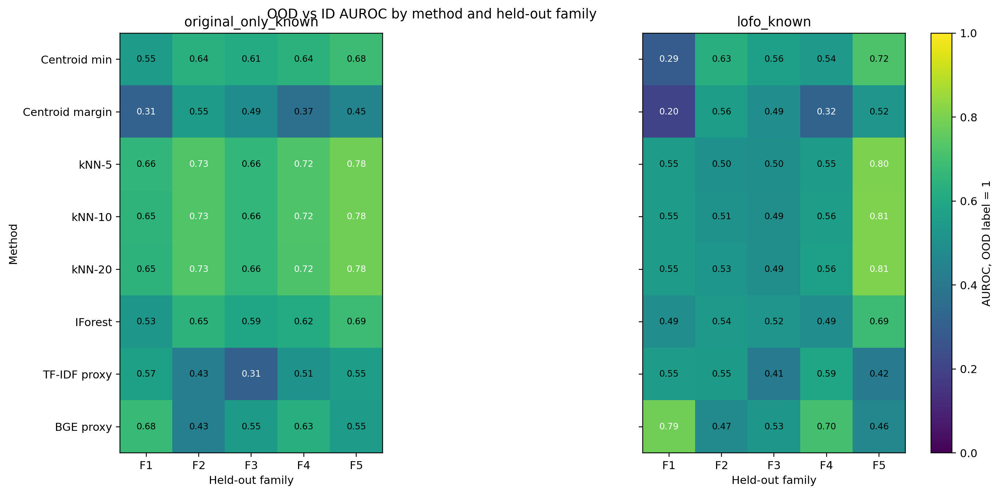

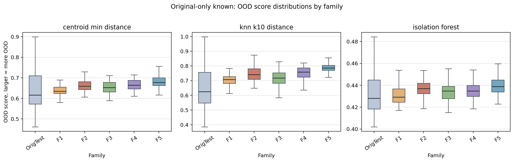

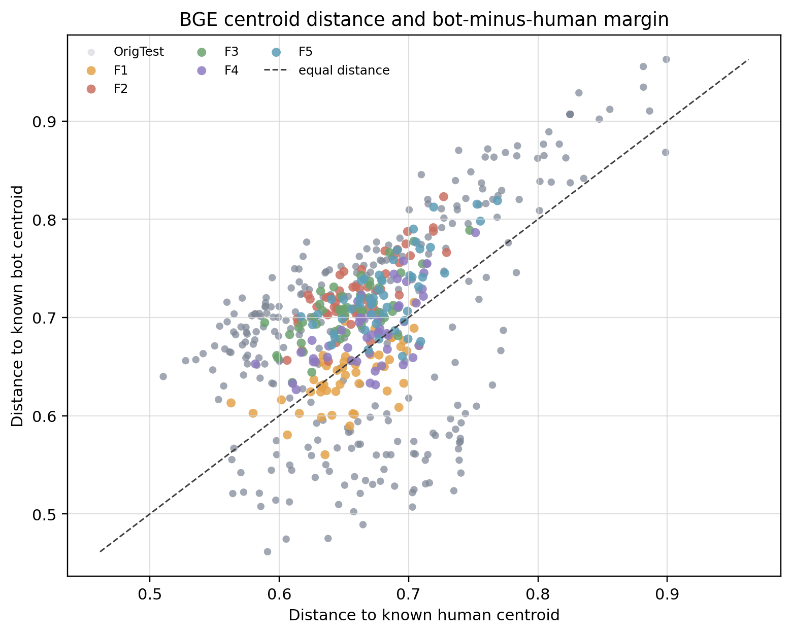

### 6.4 解读

- 平均 AUROC 最好的方法是 `bge_knn_k20_distance`，mean AUROC `0.648`。
- kNN distance 是最稳的纯 OOD 信号，original-only known 下 AUROC 更高；当 known 中已经加入其他 family 后，lofo-known 场景明显更难。
- supervised bot probability proxy 尤其 TF-IDF proxy 不适合作为纯 OOD 证据；它回答的是分类边界问题，不是分布外问题。
- OOD 方法不能替代分类器，但可以作为泛化 benchmark 的补充：当 recall 下降时，它能提示“这是没学会分类”还是“样本整体偏离已知分布”。

## 7. 跨实验综合分析

### 7.1 对实验目标的回答

我们的目标是构建能评估检测器跨 family 泛化能力的静态文本 benchmark。五个实验合起来给出以下判断：

1. **泛化失败是 family-specific 的。** LOFO 显示 F3/F5 比 F1/F2/F4 更难，说明随机切分会过度乐观。
2. **topic shortcut 需要分层解释。** 旧 BGE 语义簇控制后 recall 有下降，说明语义分布会影响检测；但新的帖子归类 topic control 下 TF-IDF 几乎不降，说明在真正按帖子话题平衡后，检测器仍能利用话题之外的风格、生成机制或其他文本信号。
3. **anchor 对齐有效但有限。** F3 更接近 human pool，同时检测概率更低；但逐条 assigned anchor 的表层相似度不高。
4. **family 指纹非常强。** Family separability 说明生成策略本身可被反向识别；这要求后续报告避免把“family 多样”简单等同于“自然多样”。
5. **OOD 是有用补充。** BGE kNN OOD 能提供中等强度信号，适合和 supervised recall 一起报告。

### 7.2 对 TF-IDF 与 BGE 的比较

- TF-IDF 的优势是强、可解释、容易吸收 family 特征；弱点是容易学到表层 family 指纹和 topic/短语 shortcut。
- BGE 的优势是语义泛化更稳；弱点是在 topic control 和 OOD 中仍受分布偏移影响，而且不如 TF-IDF 易解释。
- 因此论文中不应只报告一个检测器。TF-IDF 与 BGE 的差异本身就是 benchmark 价值的一部分。

### 7.3 对后续动态实验的启发

- 静态文本阶段已经证明 family-level holdout 是必要的；动态行为/图网络实验也应采用 held-out family 或 held-out behavior policy。
- 未来生成器不能只做 prompt 多样化，还要降低 family 指纹，例如混合策略、随机化行为政策、减少模板化改写痕迹。
- 对检测器评估应同时报告 supervised recall、topic-controlled recall、family separability、OOD AUROC。这样才能说明检测器到底在学什么。

## 8. 局限性

- 这是静态文本实验，不包含图结构和时间行为。
- BGE embedding 是用户级 doc embedding，部分 comment-level 分析复用了用户级表示。
- 旧 Semantic-Cluster-Controlled 实验的 topic 是无监督聚类，不等同于人工语义主题标签；新 Thread-Derived Topic-Controlled 实验更严格，但仍是规则化粗粒度分类，不等同于人工阅读全文后的细粒度标注。
- Family separability 的测试集较小，结论更适合作为 fingerprint 信号，而不是估计精确泛化误差。
- OOD AUROC 中等，不应被解释为已经解决未见 family 检测。

## 9. 建议放入论文/汇报的最短结论

> 静态文本 family benchmark 显示，检测器在随机切分下可能表现很好，但在 held-out family、topic control 和 OOD 条件下会暴露不同形式的泛化压力。F3/F5 是更有价值的难例；anchor alignment 可以让生成文本更接近 human pool，但不同 family 仍留下明显生成机制指纹。因此，本 benchmark 的核心价值不是制造单个“更像人”的 bot，而是用多 family 分布系统测量检测器的跨家族泛化能力与失败机制。

## 新增实验：Thread-Derived Topic-Controlled Detection

旧的 BGE 聚类实验只能说明“语义簇控制”下的结果，不能作为严格 topic control。新的正式实验已经改为帖子级 topic：只用帖子 `posts` 字段和 `subreddit` 做规则归类，再在同一 topic 下聚合多个帖子并抽取等量 human/bot 评论。

关键产物：

- `results/thread_topic_controlled/post_topic_map.csv`
- `results/thread_topic_controlled/comment_topic_dataset.csv`
- `results/thread_topic_controlled/topic_resource_audit.csv`
- `results/thread_topic_controlled/topic_matched_detection_metrics.csv`
- `results/thread_topic_controlled/leave_one_topic_out_metrics.csv`
- `results/thread_topic_controlled/leave_posts_out_within_topic_metrics.csv`
- `results/thread_topic_controlled/THREAD_TOPIC_CONTROLLED_REPORT_CN.md`

正式论文或汇报中的 topic-control 结论应优先引用这个新实验；原 BGE 聚类实验保留为探索性补充。
