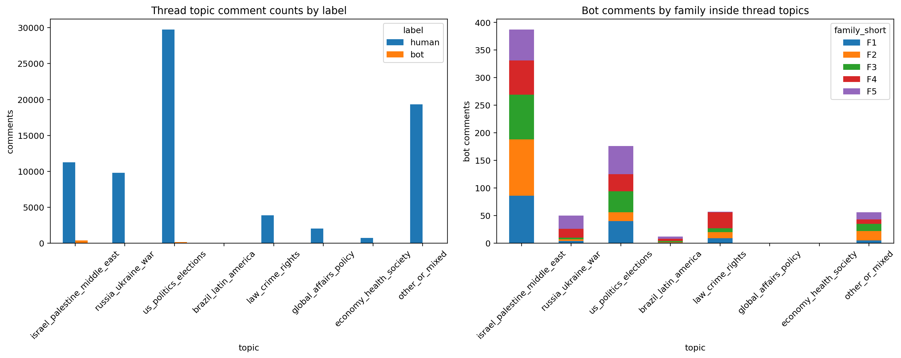
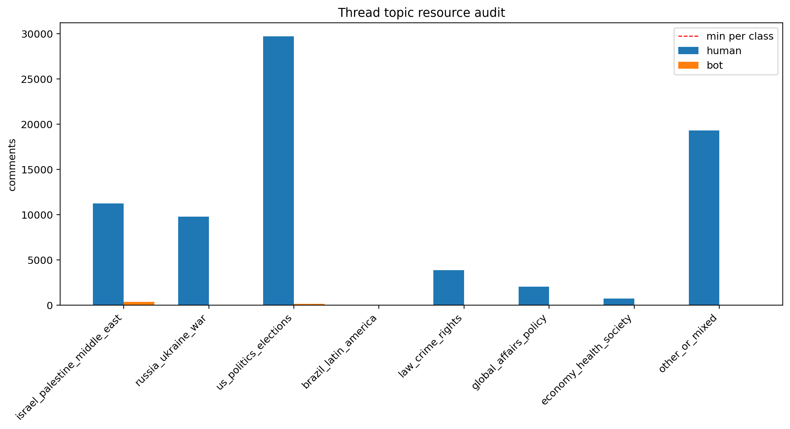
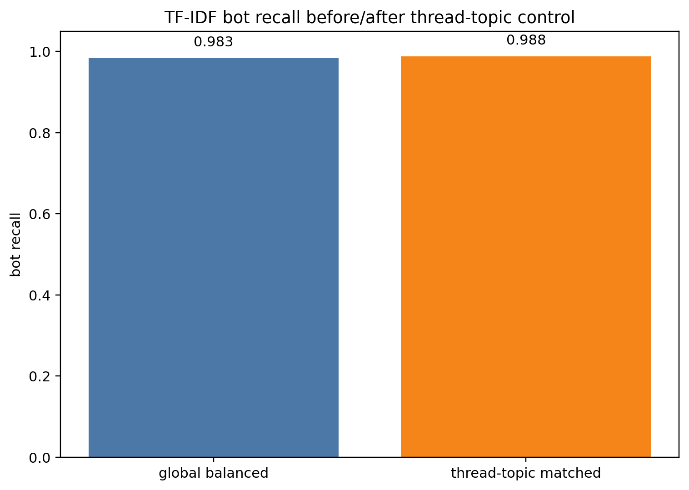
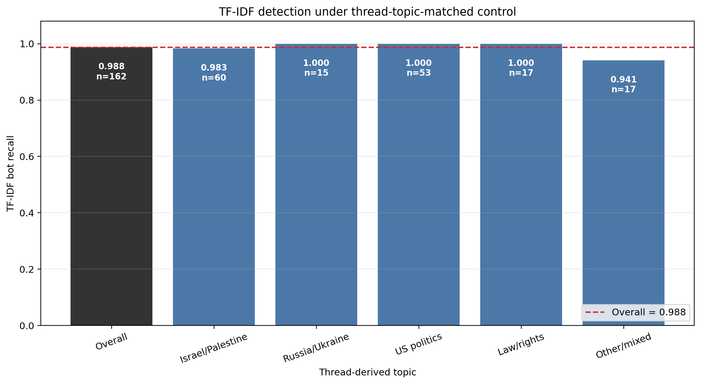
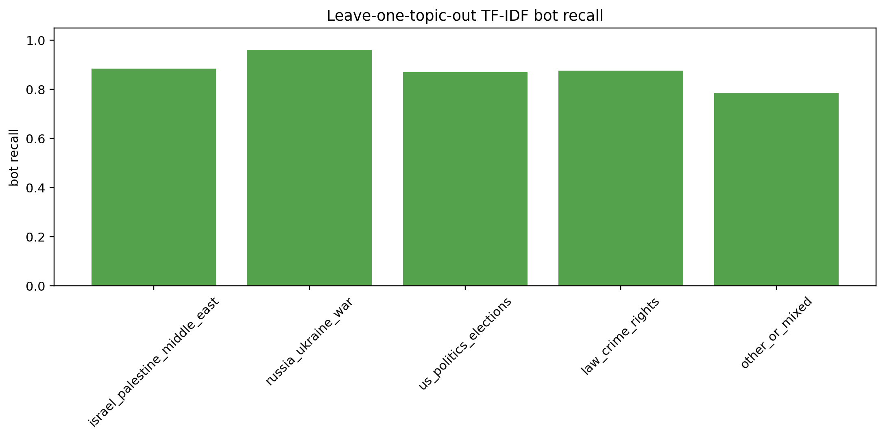
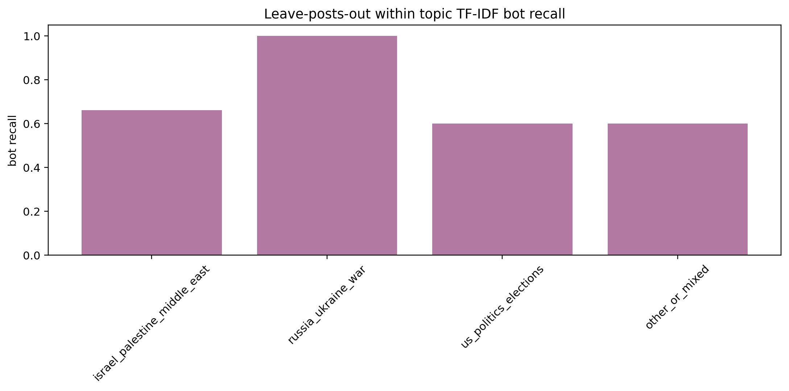

# Thread-Derived Topic-Controlled Detection 报告

## 这个实验重做了什么

旧的 `Topic-Controlled Detection` 使用 BGE embedding 对评论聚类。这个做法适合探索语义簇，但不能严格等同于 topic control，因为 BGE cluster 可能同时混入话题、语言风格、人机差异和 family 差异。

本实验改为使用 Reddit 的帖子结构：先只根据帖子 `posts` 字段和 `subreddit` 给帖子归类，再把同一话题下多个帖子的 human/bot 评论聚合起来检测。topic 分类没有读取评论正文，也没有读取 label 或 family。

## 数据构建审计

- 帖子 topic map：`52672` 个唯一 `link_id`。
- human 原始评论：总计 `79137`，可映射到帖子 topic `77943`，未映射 `1194`。
- bot 生成评论：总计 `738`，可映射到帖子 topic `738`，未映射 `0`。
- 最终可用 comment-topic 样本：`77533`。

## Topic 资源表

```text
                       topic  n_posts  human_comments  bot_comments  family_count_F1  family_count_F2  family_count_F3  family_count_F4  family_count_F5  eligible_for_matched  eligible_for_leave_posts_out                                                                       skip_reason
israel_palestine_middle_east     2299           11253           387               86              102               81               62               56                  True                          True                                                                                  
          russia_ukraine_war     1476            9797            50                4                3                3               16               24                  True                          True                                                                                  
       us_politics_elections     6162           29723           176               40               16               38               31               51                  True                          True                                                                                  
        brazil_latin_america       20              48            12                1                1                2                4                4                 False                         False   low_resource_human=48_bot=12;post_label_coverage_low_human_posts=18_bot_posts=3
            law_crime_rights     1186            3879            57                9               11                7               29                1                  True                          True                                                                                  
       global_affairs_policy      677            2041             0                0                0                0                0                0                 False                         False low_resource_human=2041_bot=0;post_label_coverage_low_human_posts=677_bot_posts=0
      economy_health_society      226             727             0                0                0                0                0                0                 False                         False  low_resource_human=727_bot=0;post_label_coverage_low_human_posts=226_bot_posts=0
              other_or_mixed     5775           19327            56                5               17               13                8               13                  True                          True                                                                                  
```

## Protocol A: Topic-Matched Aggregate Detection

问题：在每个大话题内聚合多个帖子，并在每个 topic 内抽取等量 human/bot 后，TF-IDF 检测器还能否识别人机文本？

```text
    model                                        status  baseline_total_retained  matched_total_retained  baseline_global_balanced_bot_recall  topic_matched_bot_recall  bot_recall_drop_vs_global_balanced  topic_matched_human_recall  topic_matched_macro_f1
TF-IDF+LR                                            ok                      400                    1078                             0.983333                  0.987654                           -0.004321                    0.962963                0.975305
   BGE+LR bge_skipped_no_comment_level_local_embeddings                      400                    1078                                  NaN                       NaN                                 NaN                         NaN                     NaN
```

- TF-IDF 全局随机平衡 baseline bot recall = `0.983`。
- TF-IDF 帖子话题控制后 bot recall = `0.988`。
- 二者差值 = `-0.004`。正值表示控制话题后检出下降，说明原检测可能利用了部分话题分布差异；接近 0 表示 topic control 后仍保留较强文本识别能力。

### Topic 内检出率直观对比

下表和图把 `Overall` 与各个可用 topic 的 TF-IDF bot recall 放在同一个横轴上。若每个 topic 都接近 Overall，说明粗粒度帖子话题不是主要影响源。

```text
   display_topic  bot_recall  bot_test_n
         Overall    0.987654         162
Israel/Palestine    0.983333          60
  Russia/Ukraine    1.000000          15
     US politics    1.000000          53
      Law/rights    1.000000          17
     Other/mixed    0.941176          17
```

## Protocol B: Leave-One-Topic-Out

问题：如果一个大话题完全不进入训练集，检测器能否泛化到这个未见 topic？

```text
    model                heldout_topic                                        status  train_n  test_n  test_human_n  test_bot_n  human_recall  bot_recall  macro_f1
TF-IDF+LR israel_palestine_middle_east                                            ok    678.0   400.0         200.0       200.0      0.965000    0.885000  0.924880
TF-IDF+LR           russia_ukraine_war                                            ok    978.0   100.0          50.0        50.0      0.960000    0.960000  0.960000
TF-IDF+LR        us_politics_elections                                            ok    726.0   352.0         176.0       176.0      0.943182    0.869318  0.906122
TF-IDF+LR             law_crime_rights                                            ok    964.0   114.0          57.0        57.0      0.947368    0.877193  0.912173
TF-IDF+LR               other_or_mixed                                            ok    966.0   112.0          56.0        56.0      1.000000    0.785714  0.891613
   BGE+LR                      __all__ bge_skipped_no_comment_level_local_embeddings      NaN     NaN           NaN         NaN           NaN         NaN       NaN
```

- 可运行 held-out topic 数：`5`。
- 可运行 topic 的平均 bot recall：`0.875`。

## Protocol C: Leave-Posts-Out Within Topic

问题：在同一大话题内，训练帖子和测试帖子完全不重叠时，检测器是否仍能识别？这个协议最严格，但也最容易受样本不足限制。

```text
    model                        topic                                          status  train_posts  test_posts  train_n  test_n  human_recall  bot_recall  macro_f1
TF-IDF+LR israel_palestine_middle_east                                              ok        152.0       102.0    400.0   272.0      0.992647    0.661765  0.822343
TF-IDF+LR           russia_ukraine_war                                              ok         38.0        15.0     72.0    28.0      1.000000    1.000000  1.000000
TF-IDF+LR        us_politics_elections                                              ok        166.0         6.0    342.0    10.0      1.000000    0.600000  0.791667
TF-IDF+LR             law_crime_rights skipped_no_disjoint_post_split_with_both_labels          0.0         0.0      0.0     0.0           NaN         NaN       NaN
TF-IDF+LR               other_or_mixed                                              ok         62.0         9.0    102.0    10.0      0.600000    0.600000  0.600000
   BGE+LR                      __all__   bge_skipped_no_comment_level_local_embeddings          NaN         NaN      NaN     NaN           NaN         NaN       NaN
```

- 可运行 leave-posts-out topic 数：`4`。
- 可运行 topic 的平均 bot recall：`0.715`。

## 图表













## 结论边界

- 这个实验比 BGE 聚类版更适合写成正式 topic control，因为 topic 来自帖子而不是评论 embedding。
- 由于 bot 生成评论集中在 36 个候选帖子上，严格同帖 human/bot 平衡不可行；本实验采用同一大话题下多帖聚合，这是当前数据条件下更稳妥的控制方式。
- BGE comment-level 检测本轮没有强行运行，因为当前没有对应的 comment-level 本地 embedding；报告中保留 `bge_skipped_no_comment_level_local_embeddings` 状态，避免把不可比的 user-level BGE 向量混入评论级实验。
