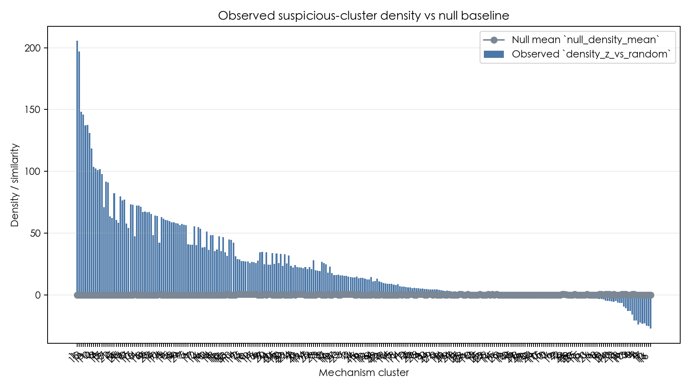
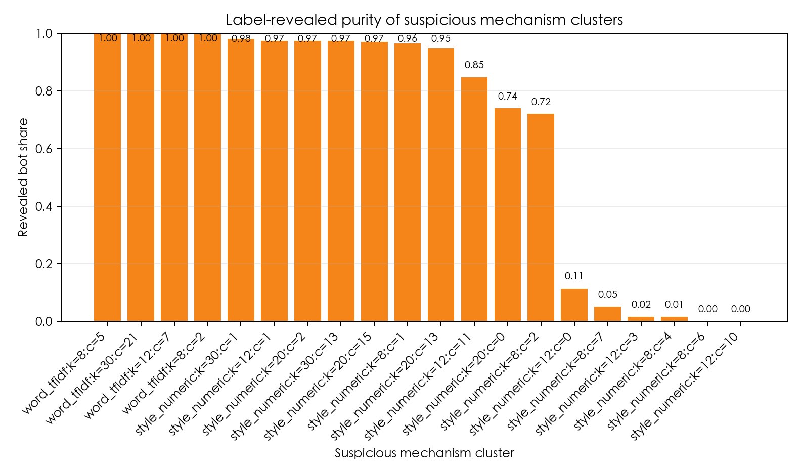
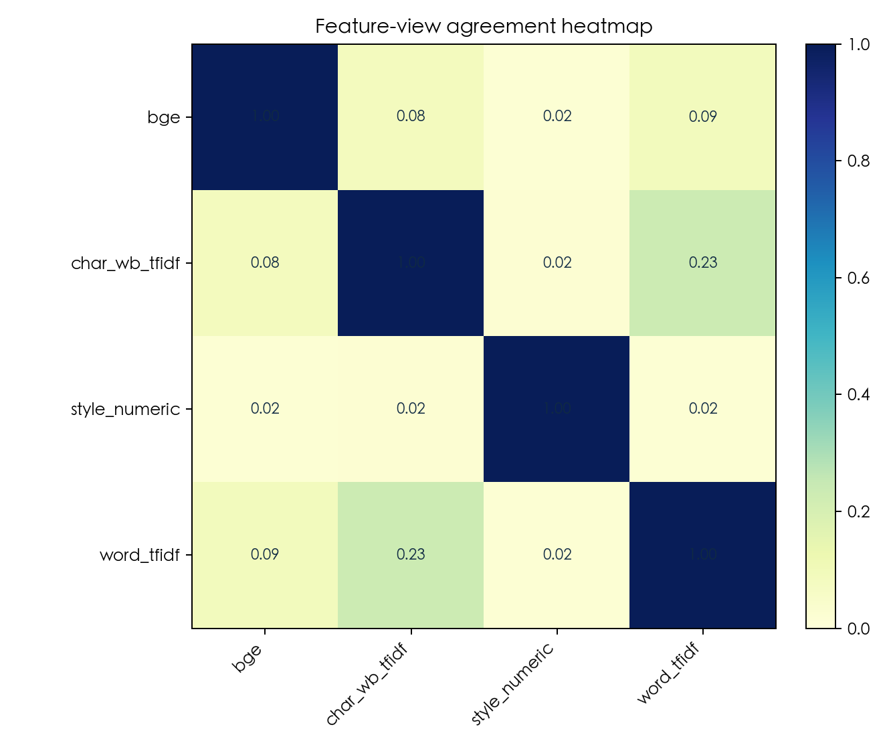
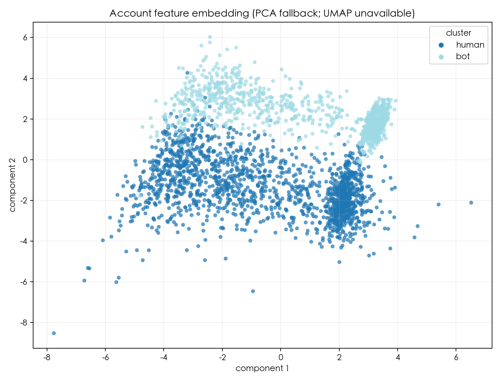

# 无监督账户机制簇发现报告

## 1. 口径与边界

- 第一阶段数据口径：`original_human` vs `original_bot`，即原始人类账号与旧版原始机器人账号的机制差异发现。
- 无监督发现阶段不使用任何账号标签；聚类、密度/null 对比、相似边和 suspicious score 都必须只由账户特征与相似结构得到。
- `label_revealed_evaluation.csv` 只用于最后揭示评估，用来解释 suspicious mechanism clusters 的标签纯度与召回线索。
- 本报告的结论单位是 `suspicious mechanism clusters`。即使某个簇的 revealed bot share 较高，也不宣称单个账号绝对是 bot。

## 2. 输入文件

- 输出目录：`unsupervised/outputs/original_human_vs_oldbot`
- suspicious_cluster_scores.csv：`280` 行 x `19` 列
- label_revealed_evaluation.csv：`287` 行 x `13` 列
- cluster_assignments.csv：`42736` 行 x `7` 列
- account_features.csv：`2671` 行 x `36` 列
- account_similarity_edges.csv：`213680` 行 x `7` 列
- label_revealed_account_metadata.csv：`2671` 行 x `9` 列，若存在则只用于最终揭示评估

## 3. 发现摘要

- 账户数：`2671`
- 机制簇数：`280`
- suspicious mechanism clusters 数：`20`

### suspicious cluster 排名前列

| cluster_key | cluster_id | suspicious_score | density_z_vs_random | null_density_mean | cluster_size | revealed_bot_purity |
| --- | --- | --- | --- | --- | --- | --- |
| style_numeric:k=8:c=1 | 1 | 250.1366 | 205.6932 | 0.0096 | 553 | 0.9638 |
| style_numeric:k=12:c=1 | 1 | 239.6142 | 197.0054 | 0.0090 | 539 | 0.9740 |
| style_numeric:k=20:c=15 | 15 | 181.8301 | 148.2967 | 0.0095 | 262 | 0.9695 |
| style_numeric:k=20:c=2 | 2 | 179.4873 | 145.9058 | 0.0094 | 269 | 0.9740 |
| style_numeric:k=30:c=13 | 13 | 169.7980 | 137.1492 | 0.0092 | 256 | 0.9727 |
| style_numeric:k=30:c=1 | 1 | 168.8319 | 137.4906 | 0.0090 | 264 | 0.9811 |
| style_numeric:k=12:c=11 | 11 | 163.2713 | 131.2006 | 0.0092 | 327 | 0.8471 |
| style_numeric:k=8:c=2 | 2 | 149.4410 | 118.6523 | 0.0091 | 357 | 0.7199 |
| style_numeric:k=12:c=0 | 0 | 131.7280 | 103.5026 | 0.0088 | 239 | 0.1130 |
| style_numeric:k=8:c=6 | 6 | 130.2178 | 102.3861 | 0.0092 | 345 | 0.0000 |
| style_numeric:k=12:c=3 | 3 | 130.0174 | 101.1964 | 0.0099 | 318 | 0.0157 |
| style_numeric:k=8:c=4 | 4 | 129.5577 | 101.7192 | 0.0100 | 409 | 0.0147 |

### label reveal 单簇评估摘录

标签只在这里揭示，用来检查无监督 suspicious ranking 排名前列到底对应什么账号组成。

| suspicious_rank | cluster_key | view | k | cluster_id | selected_account_count | human_count | bot_count | bot_rate | bot_precision | bot_recall |
| --- | --- | --- | --- | --- | --- | --- | --- | --- | --- | --- |
| 1.0000 | style_numeric:k=8:c=1 | style_numeric | 8.0000 | 1.0000 | 553 | 20 | 533 | 0.9638 | 0.9638 | 0.5346 |
| 2.0000 | style_numeric:k=12:c=1 | style_numeric | 12.0000 | 1.0000 | 539 | 14 | 525 | 0.9740 | 0.9740 | 0.5266 |
| 3.0000 | style_numeric:k=20:c=15 | style_numeric | 20.0000 | 15.0000 | 262 | 8 | 254 | 0.9695 | 0.9695 | 0.2548 |
| 4.0000 | style_numeric:k=20:c=2 | style_numeric | 20.0000 | 2.0000 | 269 | 7 | 262 | 0.9740 | 0.9740 | 0.2628 |
| 5.0000 | style_numeric:k=30:c=13 | style_numeric | 30.0000 | 13.0000 | 256 | 7 | 249 | 0.9727 | 0.9727 | 0.2497 |
| 6.0000 | style_numeric:k=30:c=1 | style_numeric | 30.0000 | 1.0000 | 264 | 5 | 259 | 0.9811 | 0.9811 | 0.2598 |
| 7.0000 | style_numeric:k=12:c=11 | style_numeric | 12.0000 | 11.0000 | 327 | 50 | 277 | 0.8471 | 0.8471 | 0.2778 |
| 8.0000 | style_numeric:k=8:c=2 | style_numeric | 8.0000 | 2.0000 | 357 | 100 | 257 | 0.7199 | 0.7199 | 0.2578 |
| 9.0000 | style_numeric:k=12:c=0 | style_numeric | 12.0000 | 0.0000 | 239 | 212 | 27 | 0.1130 | 0.1130 | 0.0271 |
| 10.0000 | style_numeric:k=8:c=6 | style_numeric | 8.0000 | 6.0000 | 345 | 345 | 0 | 0.0000 | 0.0000 | 0.0000 |
| 11.0000 | style_numeric:k=12:c=3 | style_numeric | 12.0000 | 3.0000 | 318 | 313 | 5 | 0.0157 | 0.0157 | 0.0050 |
| 12.0000 | style_numeric:k=8:c=4 | style_numeric | 8.0000 | 4.0000 | 409 | 403 | 6 | 0.0147 | 0.0147 | 0.0060 |
| 13.0000 | style_numeric:k=12:c=10 | style_numeric | 12.0000 | 10.0000 | 320 | 320 | 0 | 0.0000 | 0.0000 | 0.0000 |
| 14.0000 | word_tfidf:k=12:c=7 | word_tfidf | 12.0000 | 7.0000 | 286 | 0 | 286 | 1.0000 | 1.0000 | 0.2869 |
| 15.0000 | style_numeric:k=20:c=13 | style_numeric | 20.0000 | 13.0000 | 177 | 9 | 168 | 0.9492 | 0.9492 | 0.1685 |
| 16.0000 | style_numeric:k=8:c=7 | style_numeric | 8.0000 | 7.0000 | 303 | 288 | 15 | 0.0495 | 0.0495 | 0.0150 |
| 17.0000 | word_tfidf:k=30:c=21 | word_tfidf | 30.0000 | 21.0000 | 213 | 0 | 213 | 1.0000 | 1.0000 | 0.2136 |
| 18.0000 | word_tfidf:k=8:c=2 | word_tfidf | 8.0000 | 2.0000 | 330 | 1 | 329 | 0.9970 | 0.9970 | 0.3300 |
| 19.0000 | style_numeric:k=20:c=0 | style_numeric | 20.0000 | 0.0000 | 207 | 54 | 153 | 0.7391 | 0.7391 | 0.1535 |
| 20.0000 | word_tfidf:k=8:c=5 | word_tfidf | 8.0000 | 5.0000 | 324 | 0 | 324 | 1.0000 | 1.0000 | 0.3250 |

### Top-N suspicious clusters 并集评估

这一表按 suspicious ranking 取前 N 个簇的账号并集，展示精度和召回之间的取舍。

| top_cluster_count | selected_account_count | human_count | bot_count | bot_rate | bot_precision | bot_recall |
| --- | --- | --- | --- | --- | --- | --- |
| 1.0000 | 553 | 20 | 533 | 0.9638 | 0.9638 | 0.5346 |
| 3.0000 | 556 | 23 | 533 | 0.9586 | 0.9586 | 0.5346 |
| 5.0000 | 558 | 24 | 534 | 0.9570 | 0.9570 | 0.5356 |
| 10.0000 | 1515 | 657 | 858 | 0.5663 | 0.5663 | 0.8606 |
| 20.0000 | 2138 | 1190 | 948 | 0.4434 | 0.4434 | 0.9509 |
| 50.0000 | 2596 | 1604 | 992 | 0.3821 | 0.3821 | 0.9950 |
| 280.0000 | 2671 | 1674 | 997 | 0.3733 | 0.3733 | 1.0000 |

## 4. 图表

### 4.1 Cluster density / null distribution

未发现展开的 null sample 列，改用观测密度与 null summary 对比。

### 4.2 Suspicious cluster purity

标签只在此处用于最后揭示评估，不参与无监督发现和 suspicious score 排序。

### 4.3 Feature-view agreement

Jaccard overlap between account-similarity edge sets by feature view.

### 4.4 Account embedding

使用 23 个数值账户特征绘制；降维方法：PCA fallback; UMAP unavailable。颜色来自独立标签揭示元数据，仅用于最后揭示评估，不参与无监督发现。

## 5. 结论表述模板

- 可以说：无监督流程发现了若干与随机 null baseline 或多视角相似结构相比更集中的 suspicious mechanism clusters。
- 可以说：标签揭示后，这些 suspicious mechanism clusters 中有一部分呈现较高的 bot purity，说明它们捕捉到了 original_bot 的生成机制痕迹。
- 不应说：模型已经在无监督阶段识别出所有 bot，或某个单账号必然是 bot。
- 后续若扩展到新 family，应继续沿用“先无标签发现机制簇，再揭示标签评估”的顺序，避免把 label 信息泄漏进发现阶段。
